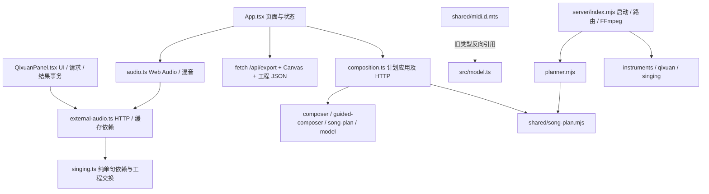

# v0.2.1 现状审计（修改前）

> 这是解耦实施前的历史快照；下文依赖图与预计修改清单不是现行待办。实施后目录/边界见 [TEAM_WORKFLOW](TEAM_WORKFLOW.md)，当前接入任务见[计划](plans/free-creation-integration.md)。

基线：`5047917`，2026-11-05；工作区干净。已阅读根目录 `AGENT.md`、源码、共享 Schema、现有单元/接口/E2E 测试。没有重写引擎的必要。

| 模块 | 问题 | 最小迁移 |
|---|---|---|
| App.tsx | 四页 JSX 与请求、持久化、播放循环、WAV/PV 编排混合 | 状态协调进入 hooks/useStudio；工程与导出进入 features；JSX 保留布局 |
| QixuanPanel.tsx | 组件发 HTTP、核对异步结果、改历史缓存、串行生成 | useQixuan 管交互；features/singing 管依赖校验与结果事务 |
| audio.ts | 浏览器引擎方向合理，但直接 fetch 状态和资产 | 保持混音与合成；所有网络经 api/client |
| composition.ts | 纯计划保护逻辑与 fetch 混合 | 保留旧导出入口兼容调用方；请求委托 api/client |
| external-audio.ts | HTTP、资产检查、WAV 导入混合 | HTTP 委托 API；原有稳定接口保留 |
| server/index.mjs | 启动与 FFmpeg 服务、输入校验、路由混合 | routes 挂载 HTTP；services 放编码；现有引擎模块继续作为服务 |
| shared | SongPlan / MIDI 已有，器乐、歌声和导出 Schema 散落服务端；MIDI 声明反向引用 src/model | shared/contracts 统一复用；SongPlan 不重建；MIDI 基础类型由 shared 定义，前端扩展 |

前端原来可离线使用本地规则、Web Audio、JSON/WAV，但声库信息、生成/重唱、FluidSynth、PV 必须连接真实后端；还没有独立 Mock 模式。Vite 固定代理到 3001，且代理管理后台。现有后台 loopback / Host / Origin / CSRF / DPAPI 限制必须保留。

现有测试覆盖：旧工程恢复、SongPlan 字段实际影响音符、锁定/手写保护、失败原子性、MIDI/USTX/DS、单句依赖、真实 FluidSynth、页面真实绮萱、WAV/MP4、后台安全。真实引擎用例有本机资源前置条件，不能以夹具替代。

预计修改文件：App、QixuanPanel、EnginePanel、composition、external-audio、audio、model、shared/song-plan（仅可选 Mock 标记）、server/index、instruments、qixuan、Vite/package/Playwright 配置、环境示例、维护文档；新增 api、hooks、features、contracts、routes、services、Mock/契约测试与 CI。纯音乐算法、OpenUtau 桥接、提示词保持原实现。
