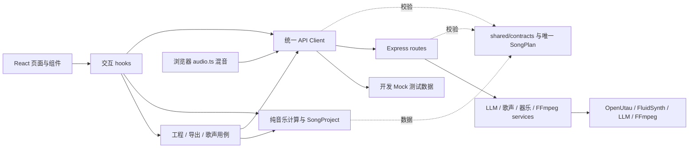

# SONGYU v0.2.1 两人协作

单仓库、React + Vite / Node + Express，通过共享契约集成。音乐计算仍可在浏览器运行。OpenUtau、FluidSynth、LLM、FFmpeg 沿用原实现。

## 从这里开始

需要 Node.js 22.12+。两人各自 clone 同一仓库，分别 `npm ci`。

前端成员（不安装任何引擎，不启动 Node 后端）：

```powershell
npm run dev:mock
# http://127.0.0.1:5173
npm run test:e2e:mock
```

后端成员（不构建、不修改 React）：

```powershell
npm run dev:backend
# http://127.0.0.1:3001/api/health；修改服务端文件自动重启
npm test
```

联调前端：`npm run dev:frontend`；本机同时启动两端：`npm run dev`。构建演示继续使用 `start.bat` 或 `npm run build` / `npm start`。

将 `.env.development.example` 复制为 `.env.development.local`，设置 `VITE_API_PROXY_TARGET=http://127.0.0.1:3001`（可以改成本地转发端口）。`VITE_API_MODE=real` 是默认值；`dev:mock` 使用提交的 `.env.mock`。不要在 `.env.local` 中设置 Mock 开关覆盖团队模式。后端 `PORT` 与密钥仍在 `.env` 或本地加密后台配置。所有 `VITE_` 值对浏览器公开，禁止写密钥。

跨设备联调优先用 SSH 将队友 API 转发到自己的 loopback 端口，再改 Vite 代理目标。不要修改后端 `127.0.0.1` 监听地址，不开公网管理端口。Vite 默认也只监听 loopback，不代理 `/api/admin`、`/admin`、`/admin-assets`。后台直接打开后端本机地址（默认 `http://127.0.0.1:3001/admin`）；更改端口后直接使用对应端口。原有 Host / Origin / CSRF / DPAPI 限制保留。

## 文件所有权

| Owner | 负责的路径和职责 |
|---|---|
| Frontend Owner | `src/App.tsx`、`src/components/`、`src/*Panel.tsx`、`src/hooks/`、CSS、Canvas 展示、音轨可视化、歌姬展示、`src/api/mock.ts`、前端 E2E |
| Backend / Agent Owner | `server/`、`scripts/` 的引擎桥接、LLM、FluidSynth、音频缓存、FFmpeg、后端测试；`src/composer.ts`、`guided-composer.ts`、`song-plan.ts`、`composition.ts`、`singing.ts` 的音乐计算 |
| 协作适配边界 | `src/audio.ts` 是浏览器混音引擎；`src/external-audio.ts` 是资产适配；`src/features/` 是用例；修改它们先在 PR 中说明影响并由另一方看接口，不为了所有权强制搬进 Node |
| Shared Contract | `shared/`（含 MIDI、SongPlan、API Schema/声明）、`src/model.ts` 的工程数据、`src/api/client.ts`、Vite/package/CI 配置；两人共同确认 |

UI 只触发用例，不自行拼 fetch 或重算缓存依赖。后台路由只处理 HTTP 边界，服务处理引擎；服务端不导入 `src/`。共享契约禁止环境读取、密钥和 Node I/O。旧的平铺音乐模块有真实调用方，保留原路径，避免为搬目录制造冲突。

## 实际目录

```text
src/
  App.tsx                     页面组合
  components/                 Landscape / Notes 展示
  hooks/                      useStudio / usePlayer / useQixuan
  features/
    project/files.ts          工程恢复、导出及存储键
    export/files.ts           WAV / PV 用例
    singing/qixuan.ts         生成、依赖校验、历史版本事务
  api/                        client.ts / mock.ts
  audio.ts                    浏览器音频引擎（保留原路径）
  composition.ts              计划应用与保护入口（保留原路径）
  composer.ts / guided-composer.ts / model.ts / singing.ts / song-plan.ts
server/
  index.mjs                   启动、配置与装配
  routes/                     planning / instruments / qixuan / export
  services/                   planner / instruments / qixuan / export
  admin*.mjs / public/         本机管理与配置
  singing.mjs                 既有原生 DiffSinger 文件交换接口
  instruments.mjs / qixuan.mjs / planner.mjs   兼容导出
shared/
  contracts/                  API Zod Schema、TS 类型、接口变更记录
  song-plan.mjs / .d.mts       唯一 SongPlan Schema
  midi.mjs / .d.mts
scripts/                      启动、OpenUtau 桥接等
tests/                        单元、接口、browser E2E
```



## Mock 与真实模式

Mock 是浏览器内部 transport，不会回落到真实后端。固定 SongPlan 与输入灵感无关；声库、音轨响应含 `mock:true`。生成有 running / succeeded / failed 生命周期；测试音为明确标注的 PCM 正弦音，`isDemo:true`，没有歌声模型推理。页面显示 Mock 横幅与任务提示；工程 planning 标记 `mock:true`，不会提升真实 LLM verified 状态。

Mock 存档用 `songyu-mock-project-v1`，真实存档仍为 `songyu-project-v1`；Mock WAV/工程文件名含 `.mock`。Mock PV 操作下载 `.mock-export.json` 状态回执，不伪造 MP4。测试音 URL 可在页面内试听与混音，刷新后可继续使用。真实模式拒绝 Mock 响应与 Mock 歌声缓存。Mock 测试会拦截所有 HTTP `/api/` 请求，完整交互必须仍通过。

后端成员用真实接口和相同 Schema 开发服务，无需改 JSX。前端成员用 Mock 开发页面和交互，无需安装绮萱、OpenUtau、DiffSinger、FluidSynth、FFmpeg。合并前以真实模式回归，Mock 通过不代表真实引擎通过。

## 分支与 PR

- `main`：保持可演示。每个成员使用自己的 clone/worktree。
- `feature/frontend-*`：前端工作；`feature/backend-*`：后端与 Agent 工作。
- 从最新 main 开分支，做小 PR；合并前更新分支并解决冲突，不强推 main。
- 两人分别开 PR，另一方 review。共享字段变更先在 `shared/contracts/CHANGELOG.md` 提交提案，写明字段、兼容性、调用方、Mock 和测试更新，两人确认后再改；不要在各自分支定义不同版本的字段。
- 同一 PR 更新运行时 `.mjs`、相邻 `.d.mts`、Mock 与契约测试。只增加可选字段优先；删除或改义字段必须提供旧工程/调用方迁移方案。
- `.github/workflows/ci.yml` 在 main/feature push 和所有 PR 自动执行构建、单元/接口、Mock E2E、无需本地模型的真实 API E2E。维护者应把 `checks` 设为 main 必需状态检查；此提交没有修改 GitHub 分支保护设置。
- 真实引擎 PR 在有资源的 Windows 主机执行完整 `npm run test:e2e` 并附验收记录，不把 CI 的无模型测试当成真实歌声验收。

## 测试命令

```powershell
npm run build
npm test
npm run test:e2e:mock
npm run test:e2e
.\start.bat --check
```

E2E 自动启动隔离服务，默认真实前端 5183、API 3101，Mock 前端 5184；可用 `E2E_FRONTEND_PORT` / `E2E_API_PORT` / `E2E_MOCK_PORT` 改端口，不复用已运行实例。完整真实 E2E 的 FluidSynth/FFmpeg 用例要求资源已安装；绮萱用例还需 `docs/QIXUAN.md` 的本机验收工程，缺失会明确 skip。
