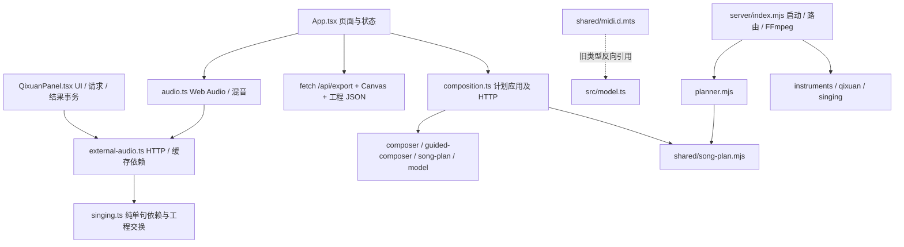

# SONGYU 迭代日志

唯一完成记录入口。新条目放在最上方，按日期倒序；同日新记录在前。每条写明工单与相关文档地址、实际实现、验证结果和未验收边界；状态 checkbox 只维护在对应工单。

以下历史证据由原 ACCEPTANCE.md、V021_ACCEPTANCE.md、V031_BACKEND_ACCEPTANCE.md、V032_BACKEND_ACCEPTANCE.md 合并，保留原执行结果与限制。它们不表示当前电脑刚通过测试。旧记录中的当时工作流或待办仅作历史；现行规则见 [AGENTS](../AGENTS.md)与[团队工作流](TEAM_WORKFLOW.md)，当前任务从 [README](../README.md#协作工单)进入。

<a id="completed-ticket-archive"></a>

## 2026-11-06 · 已完成工单归档

- 工单：[8 · 文档整理](../CC-Tasks/已完成/8-docs-consolidation.md)；规则：[AGENTS](../AGENTS.md#project-workflow)、[团队工作流](TEAM_WORKFLOW.md)；入口：[README](../README.md#协作工单)。
- 明确已完成且无未勾选事项的工单 7、8 移入 CC-Tasks/已完成/，保留编号、文件名与正文；当前任务及未明确关闭的历史方案保留原状态和位置。
- 修正归档工单内部及其他文档指向它们的相对链接；补充后续完成工单的归档规则。
- 验证：190 个本地链接与锚点通过，归档正文保留，其余 8 张工单内容与状态不变；日志日期倒序及 git diff --check 通过。纯文档调整，未运行构建或引擎测试。

<a id="docs-consolidation"></a>

## 2026-11-06 · 文档主题合并与历史归位

- 工单：[8 · 文档主题合并](../CC-Tasks/已完成/8-docs-consolidation.md)；现行文档：[协作流程](TEAM_WORKFLOW.md)、[架构与接口](ARCHITECTURE.md)、[引擎与后台](ENGINES.md)。
- docs 从 12 份收敛为 4 份（含本日志）；API/compose/production/调教混音归入架构，后台/声库/资源/许可归入引擎说明，不再按版本分散保留交接文件。
- 原最小实现、P2.1 后续建议和解耦迁移方案转为[历史工单 9](../CC-Tasks/9-initial-workbench.md)、[10](../CC-Tasks/10-guided-composition.md)、[11](../CC-Tasks/11-frontend-backend-decoupling.md)；后台后续方向转为[工单 12](../CC-Tasks/12-admin-backlog.md)，保持待排期。当前工单 4/5/6 的 18 项待办状态保留。
- 历史检查、安装清单、原机器路径、验证数字、缺口与停止点回收到各自日期；不改变当时通过/失败/未验收结果。新桥接编译示例仅按现有项目属性整理，未执行。
- 验证：185 个本地 Markdown 链接与锚点通过；原日志 102 段正文及旧锚点保留，动态旋律/绮萱实测正文、HTTP 表与 Client 约定完成迁移核对；当前 18 条任务内容/状态不变，后台 5 项方向保持待排期；13 条日志日期倒序、工单命名及 git diff --check 通过。仅文档整理，未运行构建、单元测试、E2E 或真实引擎。未推送、创建 PR 或部署。

<a id="documentation-workflow"></a>

## 2026-11-06 · 工单与文档流程统一

- 工单：[7-documentation-workflow.md](../CC-Tasks/已完成/7-documentation-workflow.md)；文档：[AGENTS](../AGENTS.md)、[团队工作流](TEAM_WORKFLOW.md)、[README](../README.md)。
- 原有 AGENT.md 与四张旧截图删除已独立提交 fd2a3a7；随后仅整理文档。
- 项目计划统一为 CC-Tasks/数字-任务简述.md；Blacktea、Toge 与共同验收分别见[工单 4](../CC-Tasks/4-blacktea-integration.md)、[工单 5](../CC-Tasks/5-toge-free-creation.md)、[工单 6](../CC-Tasks/6-joint-acceptance.md)。旧工单 2/3 缺失，保留编号空缺，不补造历史。
- 协作.md 与原 docs/plans 接入计划已拆分；旧验收汇总及三份版本报告合入本日志。历史需求、测试结果、失败与未验收边界保留；交接/技术文档继续保留并更新入口。
- 验证：138 个本地 Markdown 链接与锚点通过；三份版本报告完整正文及 15 段历史记录均保留；原计划 18 条未完成事项的内容与状态一致；11 条日志按日期倒序。工单命名、旧路径引用及 git diff --check 通过。纯文档整理，未运行 build、单元测试、E2E、真实模型或音频验收；没有推送、创建 PR 或部署。

<a id="previous-documentation"></a>

## 2026-11-06 · 前一轮文档与协作整理

来源：原 docs/ACCEPTANCE.md 同名条目。下文关于旧计划和 ACCEPTANCE 记录方式仅描述当时决定，现由上方工单流程取代。

- 基线 main `da54e03`，延续 `feature/frontend-docs`；整理 README、Agent/团队规则、协作导航、API/后台/Provider 说明及历史文档范围标记。修复旧入口与不存在的工单引用，未修改功能、测试、配置或契约运行时代码。
- 沿用本仓库原有“ACCEPTANCE 按日期汇总 + 版本验收 + 前端交接”方式，不额外要求双方维护另一份迭代日志；共同任务 checkbox 集中在[自由创作接入计划](../CC-Tasks/5-toge-free-creation.md)。文档规则见 [TEAM_WORKFLOW](TEAM_WORKFLOW.md)。
- 明确 package 0.2.1 与后端能力 v0.3.2 的区别：后端接口/核心已有交付，当前正式页面与 Mock 的新流程待接，真实新网页闭环和人工听感未验收。toge先接 Mock/最小页面，红茶提供接口材料与可复现环境，双方共同验收。
- 验证范围：逐项对照源码中的接口/Client/Schema、Mock、页面入口与启动配置；本地 Markdown 相对文件链接检查和 git diff --check 通过。仅检查本地文件链接，未检查所有外部链接或远端 CI/main 保护。
- 未运行 build、npm test、浏览器测试、真实模型/引擎或音频验收，不将历史测试数当成本次结果。工作区原有 AGENT.md 删除保持原状，不纳入本次提交；本次仅本地提交，不推送或创建 PR。

<a id="v032"></a>

## 2026-11-06 · v0.3.2 自动调教与混音

来源：原 docs/ACCEPTANCE.md 阶段摘要与 docs/V032_BACKEND_ACCEPTANCE.md；接入方法见 [v0.3.2 交接](ARCHITECTURE.md#production)。

### 原阶段摘要

最终 build、48/48 单元接口、11/11 真实引擎 E2E、2/2 Mock、启动检查通过。三组新输入真实后端制作和浏览器试听/导出完成；新正式网页输入与人工听感未验收，详见 [V032_BACKEND_ACCEPTANCE.md](iteration-log.md#v032)。

> 原执行机器的阶段验收快照；下方测试、模型与产物数字按原记录保留，不表示本机在本次文档整理中重新通过。此阶段后端已合并至 main `da54e03`；前端接线与人工听感仍未验收，统一跟踪在[计划](../CC-Tasks/5-toge-free-creation.md)。

日期：2026-11-06。分支 `feature/backend-auto-performance-mix`，开始时基于尚未合并的 v0.3.1 `799229c`；交付前核实 PR #2 已由成员合并，origin/main 为 `10c1574`。本任务保留原功能分支，PR 指向 main，不自动合并。前端接入见 [V032_FRONTEND_HANDOFF.md](ARCHITECTURE.md#production)。

### 实现范围

- Performance Auto 根据音符时值、间隔/跳进、重复、句首/句尾、标点与段落能量计算控制值。长音稳定后进入克制颤音，大跳不强行连滑；手动字段/逐音符 overrides 优先。自动标点控制带 origin=auto，重规划时替换；手动或 locked 项不覆盖。
- Auto 下 natural / soft / strong 影响实际控制，手动值仍优先。调教历史最多3版，可单句恢复，不重新调用 LLM。参数解析及渲染修订进入当前句缓存依赖。
- 共用分轨渲染入口，新增原始时间轴人声、处理后人声、伴奏、完整混音输出。低切/基础高频收敛/压缩的部分参数由实际 RMS、峰值和高频差分选择；混响可调且克制，声像按声部布局。自由工程启用，旧工程保留原行为。高峰值时统一按比例衰减限峰，原始声库文件不修改。
- 新增本机 `/api/production` 内存任务，复用 compose、FluidSynth、绮萱与现有内容缓存；实际阶段可轮询，并进入后台任务来源，配置更新期间拒绝新任务，制作运行中禁止修改配置。单句失败可单独重试，已有句不重新请求模型。
- `ready-for-mix` 只是谱面及音频资产已就绪，后续浏览器混音/导出仍由原入口执行。任务不跨进程持久化；规划失败需重新发起，不声称可以从模型推理中间态断点恢复。
- 自由工程构建与伴奏算法抽成 shared/free-score，Node 与浏览器共用，不在服务端导入 React / src。没有新增模型、下载权重或使用 OpenUtau GUI。
- 提示词明确 intent 是音乐要求，不是歌词原文；不再规定每句5–12字，允许自由句长/散文式歌体。手写歌词仍逐字保留。

### 自动回归

最终源代码冻结后：`npm run build` 通过，`npm test` **48/48**，`npm run test:e2e` **11/11**，`npm run test:e2e:mock` **2/2**，独立 `PORT=3102` 的 `start.bat --check` 通过。没有跳过或修改toge的测试源码/断言。

开发期间并行负载下有一次播放状态断言超过原5秒等待；截图仍在音频准备中。停止并行实测负载后串行重跑全部真实 E2E 通过，并非降低断言后通过。构建仍有 Zod 注释及大包提示。

新增测试涉及自动调教的长短音/大跳/休止、人工覆盖、锁定/历史、标点规则替换、自适应音量、制作阶段失败及单句重试复用。旧工程恢复、原有锁定/缓存/导出、后台保护也参与回归。

### 三组新输入的真实运行

产物根目录：`D:\ai\hacson\external\runtime\exports\v032-acceptance`。没有加载旧 A/B/C 完成工程。

| 案例 | 本次输入与结果 |
|---|---|
| A 用户新主题 | “时而悠扬时而激烈，节奏有顿挫，不甘感”，补充为音乐要求、自由歌体；真实生成《旧巷回声》，100 BPM、28.8秒、5个不等长乐句。主/副歌能量0.48/0.88。五句首次歌声均新推理 |
| B 新手写输入 | 四行新的测试歌词，以“门已经关了，我还把手放在风里”开始，逐字保留；104 BPM、约27.69秒。目录 case-b-handwritten |
| C 基于本轮 B 局部修改 | 第一音符锁定后改第二句为“我还想敲响那扇门”，真实 LLM 仅改该句；第一句/其音频及全部伴奏保持，单独改表达未改音符。目录 case-c-edit |

六次真实 `deepseek-v4.1-flash` 请求，合计 **49,740 tokens**：A 规划23.212秒/3629 tokens、旋律67.853秒/12841；B 规划33.150秒/3899、旋律56.037秒/11158；C 续写含校验修复两次32.751秒/8590、39.659秒/9623。详见无密钥 llm-calls.jsonl、各组 request / response / job / project JSON。记录的是应用请求标识、时间与模型用量，不声称保存了全部上游响应 ID。

首次生成与缓存命中分开记录：随后对 A 同一句同参数重复请求，实测 cached=true 且 audioUrl 不变。C 的新词/新表达为新推理。模型供应商的 prompt cached_tokens 与音频缓存/旧完成作品不是一回事。

A、B 对照的 baseline-project 与 project 音符逐项一致；只更改表达后分别生成“无新增自动调教 / 自动调教”原始歌声，再导出处理后人声。cache 原始44100Hz单句 WAV 与 USTX 已复制归档，浏览器 vocal-dry.wav 为24000Hz立体声时间轴，不是原文件字节拷贝。C 没有另造一份未实际生成的 baseline 文件。

三组实际通过浏览器 renderAudio 混音、全曲播放/暂停、旧 PV 页导出；包含 MIDI、伴奏、人声及最终 WAV/MP4。三份 MP4 均 H.264/AAC 720p、完整解码无错误。帧截图可见中文字幕及 AI/绮萱/DiffSinger 标识。

### 客观音频结果与边界

主样本 A（完整PCM、双声道测量）：无新增调教人声 RMS 0.06201，自动调教干声0.06467，处理后0.05981，伴奏0.01169，完整混音0.06096；完整混音峰值约0.34308，所有已测分轨削波比例0。混音综合响度 **−20.1 LUFS**、LRA **7.4 LU**、真峰值 **−9.3 dBFS**。

同工程重复混音的浮点绝对差累计约0.00052、平均约7.5e−10/采样（远低于16-bit量化步长）；不声称不同执行环境逐字节完全一致。处理顺序固定，无随机混音参数。

audio-analysis.json 包含各轨 RMS/峰值/削波、音高估计、稳定性、休止窗口和可测信号起止；基频估计有八度/泛音歧义，短音/辅音不能据此打音准分。A 干声阈值信号比目标首音早约151ms，自动调教约149ms，末端约延后20/14ms；这是信号阈值而非精确音素起点，不能据此宣称字头对齐已经人工通过。文件完整、尾部有余量不等于发音/听感优秀。

### 明确未完成的最终验收

- **正式新网页输入 → 一键成品尚未验收**：toge新自由入口、自动调教/混音控件和对应 Mock 未接线。本轮是实际后端制作 + 浏览器载入本次新工程试听/导出，不冒充正式网页从输入开始的闭环。
- **人工试听未执行**：旋律是否像练习、词节奏是否自然、咬字、突兀滑音、句尾、混响/空间感、人声是否被遮盖，都留待人耳评审。此报告不写虚构听感评分。
- 音高/稳定性与起音分析是诊断数据，不把 PCM 差异更大或参数更多当作音质更好。基础高频控制也不是完整专业动态去齿音器。
- 单音符表达 overrides 按当前句索引定位；UI 改顺序后需核对索引。新曲线修订可能使旧表达缓存过期，按提示单句重唱；无调教字段的旧缓存路径保留。
- 任务最多30条、内存保存，重启404；规划失败不保证无损恢复中间模型调用。真实模拟失败重试为注入测试，未故意破坏本机声库制造失败。

这些限制不影响上述真实作品可试听/导出，但不能据此宣称整个 v0.3.2 产品及主观音质已达最终标准。

### 原前端交接基线

## v0.3.2 红茶 → toge

2026-11-06 文档核对：本阶段后端已合并至 main（`da54e03`）；下文分支信息是交付历史。前端与 Mock 的 checkbox 见 [Toge 工单](../CC-Tasks/5-toge-free-creation.md)，共同验收见 [工单 6](../CC-Tasks/6-joint-acceptance.md)。本次不改功能代码、不重新执行推理。

开始时基于 v0.3.1 后端分支 `799229c`；交付前核实 PR #2 已合并（main `10c1574`），本轮分支 `feature/backend-auto-performance-mix`。不自动合并 main，不修改toge的组件、hooks、CSS、Mock 或 E2E 源码。

### 当时前端接入状态

新 API 和模式需补 Mock，现有 Mock 未定义路由会404，不会偷连真实模型。UI 自动调教开关、混音控件、分轨试听与正式自由入口仍由toge完成。本轮真实后端制作 + 浏览器加载工程试听/导出**不是**新正式网页从输入到作品的验收；该项和人工听感评分待双方集成，不能用旧完成工程补位。

<a id="v031"></a>

## 2026-11-06 · v0.3.1 自由作曲后端

来源：原 docs/ACCEPTANCE.md 阶段摘要与 docs/V031_BACKEND_ACCEPTANCE.md；接入方法见 [v0.3.1 交接](ARCHITECTURE.md#composition)。

### 原阶段摘要

完整自动回归通过；新自由网页与人工听感待toge接线后验收，详见 [V031_BACKEND_ACCEPTANCE.md](iteration-log.md#v031)。

> 本阶段历史验收，保留当时的未执行项与来源边界；后续执行记录见 [v0.3.2](iteration-log.md#v032)，当前前端接线/共同验收以[计划](../CC-Tasks/5-toge-free-creation.md)为准。本次未重跑测试。

基线 origin/main 480c924。仅红茶后端及工单授权的共享边界；toge UI、hooks、Mock 和前端 E2E 源码未修改。

已通过：npm run build；npm test 42/42；npm run test:e2e:mock 2/2；npm run test:e2e 11/11；PORT=3102 下 start.bat --check；git diff --check。

新增覆盖：统一规划/乐句事务、手写歌词保护、缺 Key / 规划失败不发布半成品、变长自由工程无旧模板、20–30 秒时间轴边界、伴奏避开演唱。新规划成功路径为明确的接口夹具，不是真实上游 LLM 验收。真实引擎 E2E 是原有流程回归，包含 CPU 绮萱、单句缓存、FluidSynth 和 WAV/MP4，不是新自由网页入口验收。

未执行：新自由入口从正式网页现场创作 A/B/C、真实新宏观规划与乐句联合调用、对应新作品 MIDI/全轨 WAV/MP4、中文字幕同步人工检查、调教主观试听。原因：按工单分工需toge完成 F1–F4 后统一联调；红茶不越权代改 UI。不复制旧 A/B/C 完成工程充当本轮作品。

B4 沿用已接入的 Pitch Bend / Vibrato / DYN / 辅音偏移和 preset，单句调教与缓存保护自动回归通过；不宣称已改善主观音质。本轮没有电脑操控 OpenUtau；只由现有无窗口桥接进行真实引擎回归，状态检查沿用本机管理诊断 API。

交接：[自由创作接入](ARCHITECTURE.md#composition)。新增 /api/compose 已具备后台真实阶段记录 planning/melody/validated，但普通前端尚无逐阶段订阅协议；不可模拟百分比。正式新作品需使用 projectFromComposition，不能再调用旧 applySongPlan。

已知：构建仍有 Zod 注释及 bundle 大于500kB提示；不影响检查通过。该分支只完成后端交付，不代表整个 v0.3.1 产品闭环已验收。

### 原前端交接基线

## v0.3.1 红茶 → toge接入交接

历史交接基线：origin/main `480c924`，分支 `feature/backend-free-composition`；当时只实现后端/音乐核心及授权共享字段，未修改 React、hooks、CSS、Mock、前端 E2E。该后端 PR #2 已合并，当前接线基于最新 main，并同时阅读 [v0.3.2 交接](ARCHITECTURE.md#production)。当前待办统一见[Toge 工单](../CC-Tasks/5-toge-free-creation.md)，本文件保留 compose 接入方法。

### 当时最终验收依赖

红茶自动回归不等于新自由入口网页验收。历史工单2未随仓库保存，后续按 [Blacktea 工单](../CC-Tasks/4-blacktea-integration.md)、[Toge 工单](../CC-Tasks/5-toge-free-creation.md)和[共同验收](../CC-Tasks/6-joint-acceptance.md)执行：从正式网页现场输入全新主题/歌词，不读取旧完成工程；分别验收首次真实生成与缓存命中、锁定续写、只调教重唱、全曲试听、MIDI/WAV/MP4、字幕同步及人工听感。

原交接机器输出路径为 `D:\ai\hacson\external\runtime\exports\v031-full-flow`，不是两人电脑都必须存在的目录。新验收记录实际资源根目录及产物位置；脚本可移植性仍待 [Blacktea 工单 B2](../CC-Tasks/4-blacktea-integration.md)处理，不使用旧 A/B/C 音频冒充本次完整作品。

<a id="v03-backend"></a>

## 2026-11-05 · 动态旋律与表现力后端交付

来源：原 docs/V03_BACKEND.md，首次提交 de1fda5 的 Git 日期为 2026-11-05；原文未单列验收执行时间。保留当时停止点，不把旧建议当作现行接入顺序。


> 这是 v0.3 当时的交付快照，保留停止点与测试边界，不作为当前接入顺序。后续 compose / production 已取代下文早期建工程建议，接入须读 [v0.3.1](ARCHITECTURE.md#composition) / [v0.3.2](ARCHITECTURE.md#production) 与[当前前端工单](../CC-Tasks/5-toge-free-creation.md)。历史停止/授权不延伸到新任务。

分支：feature/backend-dynamic-melody。用户要求先推送并停止后续工作。

已更新 AGENT.md / AGENTS.md：红茶只改后端、音乐核心和经授权的共享边界；toge负责组件、hooks、CSS、Mock 与前端 E2E。原有用户工单和协作文件不代为提交。

已实现：shared/contracts/melody 的 MelodyDraft / PhrasePlan / Performance；POST /api/melody；共享客户端 melody；src/melody.ts 的 createFreeProject、melodyRequest、applyMelodyDraft、setPhrasePerformance。支持 1–8 句自由歌词、主题生成、指定句生成、整句及单音符锁定、歌词保护、失败原子性、调式/强拍和弦/时值/重叠/对齐校验。旧 JSON 不自动改写音符。新本地规则采用非均匀节奏与重复音，不伪称 LLM。

演唱参数：natural / soft / strong 映射 Pitch Bend、长音 Vibrato、DYN 与 phoneme offset；毫秒按 BPM 转换 USTX tick。未提供 performance 时保留旧缓存行为；表现变化只使当前句依赖失效。BREC、VELC、PEXP 未暴露控制；本地声库 ENE 未启用，不宣称已支持这些参数。没有修改官方程序集、声库或桥接器。

真实证据在 D:/ai/hacson/external/runtime/exports/v03-dynamic：三组真实 deepseek-v4.1-flash 请求与结果、12 句绮萱 CPU 音频、工程、三组混音 WAV 与三组 25 秒 H.264/AAC 720p MP4。ffprobe 及完整解码通过。

A 手写忧伤歌词：38.396 秒、1205 输入 / 5974 输出 tokens；B 主题生成：42.090 秒、1200 / 6808；C 锁定首音续写：33.420 秒、3151 / 5375。每组通过本地音乐校验，有非均匀时值与休止；C 保留首音与非目标句。脚本请求文件中的输入为验收输入，不是模型输出模板。

相同手工旋律三种真实表现音频 RMS：natural 0.054666、soft 0.039448、strong 0.071104。不同 PCM 不能等同于主观听感更佳；尚未有人耳评分。P0 对照及自动音高估计在 ../v03-p0；自动相关法存在八度/泛音歧义，不据此虚构机械感来源百分比。

对比文件：original-mechanical.wav / dynamic-expressive.wav，歌词相同。legacy-melody.ts 仅冻结旧算法供验收，应用不使用。真实权重、密钥和音频不进 Git。

已完成 npm run build、npm test（39/39）。此前整轮真实 E2E 11/11、Mock 2/2 已通过；最后本地节奏规则调整后重新发起浏览器回归，停止时结果以执行日志为准，不把此前结果冒充最后版本验收。

toge待接入：用 createFreeProject 建短歌；melodyRequest 构造请求；api.melody 返回后用 applyMelodyDraft 原子应用；只调教用 setPhrasePerformance，然后单句重唱。钢琴卷帘、调教面板及新 /api/melody Mock 未实现，按分工留给toge。本轮没有改其 UI/Mock/前端 E2E。

后续先确认最终两套 E2E 日志，再进行主观试听、更多歌词/延音/多音字覆盖。新的曲线映射仍需更广泛的发音质量验收；当前宏观 SongPlan 沿用现有契约。

<a id="v021"></a>

## 2026-11-05 · v0.2.1 前后端协作解耦

来源：原 docs/ACCEPTANCE.md 阶段摘要与 docs/V021_ACCEPTANCE.md。

### 原阶段摘要

- 交付入口、职责、契约、Mock、Git 工作流与本轮完整验收记录见 [V021_ACCEPTANCE.md](iteration-log.md#v021)。
- 构建通过、31/31 单元与接口、11/11 真实模式 E2E、2/2 无后端 Mock E2E、独立 3102 端口启动检查通过。
- 绮萱 CPU 实际重唱、缓存保护、FluidSynth 及 25 秒 H.264/AAC MP4 已测试；本轮没有新增真实上游 LLM 调用，不以 Mock 或接口夹具替代真实推理。

> 历史执行快照：下文“未推送 / CI 尚未远端运行”等只说明本阶段当时状态，本次未核实当前远端 checks/保护设置，也未重跑测试。当前能力与待办见 [README](../README.md)和[接入计划](../CC-Tasks/5-toge-free-creation.md)。

日期：2026-11-05。基线 `5047917`，开始时工作区干净。代码在当前工作区，未创建远端 PR、未推送、未修改 GitHub 分支保护。

### 交付

- [修改前审计与真实依赖](../CC-Tasks/11-frontend-backend-decoupling.md)。
- [目录、最终依赖图、文件所有权、独立开发命令和 Git 规范](TEAM_WORKFLOW.md)。
- [API 契约与 Client 说明](ARCHITECTURE.md#public-api)，以及 `shared/contracts/CHANGELOG.md` 的共同确认模板。
- App 保留页面组合，工程/导出用例、播放器、计划请求和歌声生成移出 UI；QixuanPanel 通过 hook 触发业务模块，依赖核对、锁定保护与三版历史事务独立。
- 服务端 index 保留启动与装配；主要 HTTP 路由与 LLM / 器乐 / 绮萱 / FFmpeg 服务分开，旧入口保留兼容导出。
- API Client 集中地址、超时、错误、Schema 校验、音频下载与任务生命周期。Vite 代理可配置；管理后台仅本机直接访问，不经过 Vite 代理。
- 独立 Mock 提供固定计划、声库、任务、测试音与导出状态；独立存档、显式标记、禁止在真实模式导入 Mock 工程。Mock PV 只下载 JSON 回执。
- shared MIDI 类型不再反向依赖 src；SongPlan 仍为原共享 Schema。没有更改作曲算法、LLM 提示词、OpenUtau 桥接或 MIDI 运行时实现。

### 执行结果

| 检查 | 结果 |
|---|---|
| `npm run build` | 通过（独立执行及最终启动检查均包含构建） |
| `npm test` | 31/31 通过，无跳过 |
| `npm run test:e2e` | 11/11 通过，无跳过，真实本机引擎 |
| `npm run test:e2e:mock` | 2/2 通过，仅启动 Vite，不启动后端 |
| `.\start.bat --check` | 通过；使用 `PORT=3102` 避开原有 3001 服务，页面 / JS / API 就绪后自动停止 |
| `git diff --check` | 通过；Git 有 Windows 行尾转换提示 |

独立 Mock 浏览器用例拦截全部 HTTP `/api/` 请求，并断言请求数为零；完成计划应用、锁定与重生成、单句生成/重唱、兄弟缓存保护、试听、刷新、Mock FluidSynth 混音、WAV / 工程 / 导出回执下载。另验证 Vite 的管理路径均返回 403。

真实模式验证旧 JSON 恢复、SongPlan 成功/失败原子性、锁定/手写保护、局部重生成、FluidSynth WAV 与全曲混音、绮萱生成和试听、真实“重新演唱这一句”按钮、第二句改动后第一句资产不变、WAV 与带绮萱署名的 MP4。第一句重唱 `take=1` 本轮新推理成功（`cached:false, isDemo:false, runner:CPU`），其余有效句复用真实缓存。

本轮最终作品 25 秒；人声 RMS 约 0.04615、伴奏 RMS 约 0.01989。ffprobe 确认 MP4 为 H.264 / AAC、1280×720、25.000 秒；FFmpeg 完整解码无错误。产物沿用既有真实验收目录：`D:\ai\hacson\external\runtime\exports\qixuan-acceptance`（final-project.json、browser-acceptance.json、songyu-final.mp4 及三份 WAV）。截图在 `test-results/qixuan-page.png`、`mock-test-results/frontend.png`，均为忽略的本地测试产物。

契约迁移回归曾发现 Zod 重排 renderParameters 属性后，旧 JSON 缓存依赖字符串比较失败；已在资产适配层恢复既有字段顺序，未更换旧缓存算法，增加真实响应解析后的应用测试。开发中修改测试配置曾触发 Vite 重载，随后冻结代码完整重跑 11/11 通过；没有靠跳过或降低断言解决。

### 验收边界与已知问题

- 本轮 LLM 请求成功/失败、模型输出校验为本地接口夹具；没有新增真实上游 LLM 调用。真实引擎 E2E 使用本机既有真实 LLM 工程，不能据此声称本轮又验证了真实 LLM 提供商。
- 本轮新推理为 CPU；DirectML、OpenUtau GUI、真实手机/Safari 未重新验收。主观歌声听感、机械旋律问题明确留待下一阶段。
- 构建有 Zod 包注释及大于 500 kB 的 bundle 提示，构建仍通过；本轮未扩展到打包优化。
- GitHub Actions 工作流已落地，但尚未远端运行。CI 执行可移植检查，不安装/分发声库；完整真实引擎测试仍需有授权资源的本机。main 的必需状态检查需维护者启用。
- 既有原生 DiffSinger 文件交换接口、少量平铺纯音乐模块保留原路径；这是有意减少迁移，不要求为了目录整齐重写引擎。

### 解耦前审计（原 DECOUPLING_AUDIT）

基线：`5047917`，2026-11-05；工作区干净。已阅读根目录 `AGENT.md`、源码、共享 Schema、现有单元/接口/E2E 测试。没有重写引擎的必要。




前端原来可离线使用本地规则、Web Audio、JSON/WAV，但声库信息、生成/重唱、FluidSynth、PV 必须连接真实后端；还没有独立 Mock 模式。Vite 固定代理到 3001，且代理管理后台。现有后台 loopback / Host / Origin / CSRF / DPAPI 限制必须保留。

现有测试覆盖：旧工程恢复、SongPlan 字段实际影响音符、锁定/手写保护、失败原子性、MIDI/USTX/DS、单句依赖、真实 FluidSynth、页面真实绮萱、WAV/MP4、后台安全。真实引擎用例有本机资源前置条件，不能以夹具替代。

原迁移表与预计文件范围见[历史工单 11](../CC-Tasks/11-frontend-backend-decoupling.md)。

<a id="qixuan"></a>

## 2026-11-05 · v0.2 绮萱真实演唱

来源：原 docs/ACCEPTANCE.md；引擎与许可说明见 [QIXUAN](ENGINES.md#bridge)。

- 最终 `npm run build`、`npm test`（25/25）、`npm run test:e2e`（11/11）通过；`start.bat --check` 在独立 3307 端口通过。原有锁定回归固定为本地规则夹具，防止后台配置真实 Key 后产生意外调用。
- 绮萱 v2.7.0、官方 2025.02 声码器与未修改的 OpenUtau 0.1.576 程序集实际推理成功；CPU 21.686 秒、DirectML 16.861 秒生成“海风吹过我的窗”。编辑器实际识别 DIFFS ZH、DIFFSINGER 和绮萱。
- 网页真实按钮验证单句生成、试听、修改第二句后新音频、第一句缓存不变、历史对比、完整混音及 MP4 下载。首次约 3.3 分钟（含模型加载与全曲合成），后续依赖相同复用缓存。
- 真实 LLM 两组意图严格校验成功，13.048 / 11.844 秒，2327 / 2266 tokens；锁定鼓轨保留；输出 281 / 664 个器乐音符及不同的非静音 WAV。密钥未输出。
- `external/runtime/exports/qixuan-acceptance` 已交付请求的 USTX、单句 WAV、伴奏 WAV、人声 WAV、混音 WAV、25 秒 H.264/AAC MP4 与 acceptance-report.md；另有 SHA256、推理、GPU 采样和 LLM 记录。MP4 解码与混音 WAV 的相关性 0.999970。
- 原测试按钮增加就近结果、忙碌提示、超时处理；实测已有配置可达。不是把“已配置”当作“完整音乐方案已验证”。
- 主观听感、多音字与长句覆盖仍待进一步试听；GPU 全卡采样含其他作业，不能当作本模型专属峰值。完整限制和路径见 [QIXUAN.md](iteration-log.md#qixuan)。

### 原机器安装与编译（原 QIXUAN）

- OpenUtau Portable：`external/OpenUtau`，0.1.576；源码核对 tag 0.1.576，MIT，commit `bc194b6fe4897427a73066390b286e11205fd10f`。
- 绮萱：`external/voicebanks/Qixuan-v2.7.0/Qixuan_v2.7.0_DiffSinger_OpenUtau`，官方发行 ZIP 420707627 字节，解压 540817652 字节。条款随包保存，并记录官方来源。
- 声码器：`external/vocoders/2025.02`，`pc_nsf_hifigan_44.1k_hop512_128bin_2025.02`，ONNX 56616643 字节。OpenUtau 的 Dependencies 下使用目录联接定位原文件，无权重副本。
- .NET SDK：`external/runtime/dotnet`，10.0.403。桥接输出 `external/OpenUtau/SongyuBridge.dll`；中间文件在 `external/runtime/bridge-obj`。
- OpenUtau Additional Singer Path 已设置为 `external/voicebanks/Qixuan-v2.7.0`，原 prefs.json 备份在同目录 `.songyu-v02-backup`。

```powershell
cd D:\ai\hacson\music_agent
D:\ai\hacson\external\runtime\dotnet\dotnet.exe build scripts/openutau-bridge/SongyuBridge.csproj `
  -p:OpenUtauDirectory=D:/ai/hacson/external/OpenUtau `
  -p:BaseIntermediateOutputPath=D:/ai/hacson/external/runtime/bridge-obj/ `
  -o D:/ai/hacson/external/OpenUtau
```

官方来源：[绮萱发行页](https://github.com/yqzhishen/qixuan-diffsinger/releases/tag/v2.7.0)、[使用条款](https://github.com/yqzhishen/qixuan-diffsinger/blob/main/terms_of_use/Terms_of_Use.zh-CN.md)、[OpenUtau](https://github.com/openutau/OpenUtau)、[声码器发行页](https://github.com/openvpi/vocoders/releases/tag/pc-nsf-hifigan-44.1k-hop512-128bin-2025.02)。引擎许可证与声库 / 声码器许可分别适用；声码器包附带 CC BY-NC-SA 4.0 声明，商业用途需另核对具体适用条款。

### 真实验证明细（原 QIXUAN）

已实际验证官方 USTX 加载、中文音素、CPU / DirectML 真实单句推理与网页逐句操作。不是预录声音、TTS 或元音演示。

首句“海风吹过我的窗”：CPU 21.686 秒、DirectML 16.861 秒；5.4 秒、44100 Hz、非静音。主机进程峰值工作集分别约 1.178 / 1.184 GB。DirectML 明确选中 RTX 4060 Laptop；GPU 同时运行其他程序，全卡显存采样不能当作本模型专属峰值。

两组真实 LLM 请求使用后台既有密钥，均通过方案校验，耗时 13.048 / 11.844 秒；2327 / 2266 tokens，锁定鼓轨未变。没有在日志、截图或报告中输出 Key。

真实网页用例 `tests/browser/qixuan.spec.ts` 验证点击生成、试听、第二句修改后新音频、第一句缓存不变、历史版本、全曲 25 秒混音与真实 MP4 下载。其前提是已安装模型且存在本机真实 LLM 验收工程；缺少原生引擎时明确跳过，不使用假音频。

验收文件在 `external/runtime/exports/qixuan-acceptance`，含 USTX、单句、分轨、最终 WAV / MP4、安装 SHA256 清单、LLM 与推理记录。听感、中文多音字、长句节奏、移动设备仍需用户试听与进一步覆盖；不会把非静音数值当作主观音质验收。

模型和缓存不提交 Git；源代码、测试和安装说明可以提交。

### USTX 兼容修复记录

原 USTX 导出空 pitch.data 配合 snap_first=true 会在真实编辑器中越界，现已补齐控制点；绮萱工程选择 DIFFS ZH 与 DIFFSINGER，通用手动交换仍保留。

<a id="admin-engine"></a>

## 2026-11-05 · 本地后台与引擎集成

来源：原 docs/ACCEPTANCE.md；后台说明见 [ADMIN](ENGINES.md#admin)。

- 构建通过；23 项单元 / 接口测试通过，包括真实 Windows DPAPI、密钥脱敏与管理请求保护。
- 后台隔离浏览器测试通过：配置保存、聊天接口夹具联通、实际规划路由使用新配置、任务结果、资源扫描、刷新脱敏和手机布局。
- FluidSynth 四类乐器已生成非静音 WAV；样本位于仓库外 `external/runtime/exports/acceptance`。
- 全量浏览器回归首跑 9/10 通过，P2.1 全曲播放在并行构建时超过原有 5 秒断言等待；停止构建后原用例单独重跑通过（未跳过、未修改断言）。共 10 个用例均有通过记录，包括 FluidSynth 全曲 WAV / MP4、外部人声夹具及原有 UI 流程。
- `start.bat --check` 在独立 3307 端口通过，页面、构建资产与 API 均就绪并自行停止。本机回归使用现存 FFmpeg：`D:\aii\ffmpeg-master-latest-win64-gpl-shared\bin\ffmpeg.exe`；该机器路径不固化为源码默认值，可在后台填写。
- 真实 LLM、真实中文演唱、OpenUtau GUI 导入及听感仍未验收。工程交换与 WAV 夹具测试不能替代这些验收。
- 配置管理与后续后台需求见 [ADMIN.md](ENGINES.md#admin)。第三方权重与密钥不进入 Git。

### 后台验证覆盖（原 ADMIN）

`npm test` 包含真实 Windows DPAPI 加解密、密钥保留 / 清除 / 重载、不回显密钥、无效配置保留旧文件、Host / Origin / CSRF 拦截和真实 HTTP 任务状态。

`tests/browser/admin.spec.ts` 使用独立临时后端和明确标识的聊天接口夹具，实际填写密码框、加密写盘、调用连通检查和 `/api/plan`、刷新后脱敏、资源扫描及桌面 / 手机布局。测试不改用户配置，不宣称真实商业 LLM 已接通。

### 原机器资源路径（原 ADMIN）

FluidSynth 当前安装在 `external/FluidSynth/fluidsynth-v2.6.2-win10-x64-cpp11/bin/fluidsynth.exe`；OpenUtau 在 `external/OpenUtau/OpenUtau.exe`；DiffSinger 在 `external/DiffSinger`，独立 Python 为 `.venv/Scripts/python.exe`。测试音源为 MuseScore 官方仓库发布的 FluidR3Mono_GM.sf3（不是宣称 MuseScore General 最新版），许可证保留在外部 soundfonts 目录。第三方引擎、权重及安装包都不推送。

<a id="p21-review"></a>

## 2026-11-05 · P2.1 重复工单复核

来源：原 docs/ACCEPTANCE.md 两个复核条目；技术背景见 [P21](ARCHITECTURE.md#project-data)。

### 当时复核快照

当时 P2.1 已在 main 实现；构建通过、16 项单元/接口测试通过，浏览器测试为 **6 通过 / 1 失败**。失败项为 MP4 导出，原因是当时环境缺少 FFmpeg，按钮处于禁用状态。此失败保留，不用其他日期成功结果覆盖。

### 复核细节

- 核对本地及远端 main 的 `e705b1b`：已有共享严格 SongPlan、LLM 规划接口、计划驱动音符、锁定兼容、意图展示、离线规则和三种能力状态。无需重复实现。
- 本次 `npm run build` 退出码 0；`npm test` 16 通过、0 失败。
- 本次 `npm run test:e2e` 退出码 1：6 通过、1 失败。三项 P2.1 浏览器用例全部通过，同 ID/版本的不同意图仍能产生不同且非静音的 PCM；锁定内容不变；无效 LLM 响应不覆盖存档；本地回退可用。
- 原有 MP4 用例因 `getByRole('button', {name:'导出 MP4', exact:true})` 实际 disabled 而失败。实测 health 的 ffmpeg=false；未执行本次视频编码。
- 当前 PATH 无 FFmpeg，且原来的绝对路径文件不存在；恢复 FFmpeg 和字体/编码依赖后，需重启服务再运行 MP4 回归。未改动导出实现、未跳过或伪造该测试。
- 没有配置或调用真实 LLM；模型质量、延迟、成本和真实手机/Safari 仍未验收。LLM 测试成功是夹具成功，不是真实服务验收。
- 完整需求映射及文件清单见 [P21.md](iteration-log.md#p21-review)。

### P2.1 复核明细（原 P21）

复核开始时，本地 main 与 origin/main 均为 `e705b1b`，工作区干净；该提交已经包含完整 P2.1 实现。本次核对实际源码并重新执行检查，没有另写第二套规划/作曲逻辑，也没有改动稳定的 PV 导出链路。

| 工单要求 | 当前对应实现 |
|---|---|
| 有限、经过校验的 SongPlan | `shared/song-plan.mjs`；包括调性、情绪/强度、四级数和弦进行、鼓点密度、旋律走势/音域和四段能量 |
| LLM 返回可执行方案、Key 仅服务端 | `server/planner.mjs`；请求和输出均校验，完整响应通过后才标记 verified |
| 真正影响音乐 | `src/guided-composer.ts`；计划直接决定 MIDI 音高、事件密度、时值和力度 |
| 离线回退、保护原有创作 | `src/song-plan.ts`、`src/composition.ts`、`src/composer.ts`；保留旧工程作曲器和手写歌词/节奏 |
| 锁定与和声兼容 | 冻结受保护音高所在段落的有音高内容，并维持原调性/和弦；只锁鼓不冻结和声 |
| 新手可读说明和真实能力标注 | `src/App.tsx` 的创作意图与兼容说明；区分 local / unverified / verified |
| 回归测试 | `tests/plan.test.ts`、`tests/server.test.mjs`、`tests/browser/plan.spec.ts` 加原有测试 |

本次真实结果：

- `npm run build`：通过；仍只有已知的 Zod PURE 注释提示。
- `npm test`：16 项通过，0 失败。
- `npm run test:e2e`：6 项通过，1 项失败。P2.1 三项浏览器测试全部通过；原有节奏/编辑/持久化、手机布局和真实 PCM/字幕边界测试通过。
- 唯一失败是原有 MP4 导出用例：当前环境未找到 FFmpeg，`/api/health` 报告 ffmpeg=false，因此导出按钮正确禁用，用例在 toBeEnabled 断言处失败。它不是一次成功的视频编码，不能按此前环境的成功记录标为本次通过。
- 原配置路径 `D:\ai\ffmpeg-master-latest-win64-gpl-shared\bin\ffmpeg.exe` 本次已不存在，PATH 也未找到 FFmpeg。需要恢复带 libx264/libass 的 FFmpeg，并通过 PATH 或 FFMPEG_PATH 配置后，重跑该用例。没有用模拟输出、跳过用例或更改 PV 实现来掩盖问题。
- 本机仍无 `.env` / LLM Key；真实 LLM 未调用。成功、错误格式、越界、超时和 HTTP 错误仍以明确的测试夹具验证。

当时结果现已合入 [迭代日志 P2.1 复核](iteration-log.md#p21-review)。本轮代码无需重复实现，提交仅更新复核与验收记录。

<a id="windows-launcher"></a>

## 2026-11-04 · Windows 启动脚本

来源：原 docs/ACCEPTANCE.md 未单列日期的启动脚本记录；实现提交 e705b1b 的 Git 日期为 2026-11-04，原记录未单列验收执行时间。

- 新增 `start.bat` 和 `scripts/start-local.mjs`，默认安装缺失依赖、构建最新源码、启动单一 Express 服务，页面/构建资产/API 就绪后调用默认浏览器。`--check` 不打开浏览器，验证后自行停止。
- 在当前目录执行 `start.bat --check` 成功，复用现有依赖，返回页面、JS 资产及 health 200。
- 将源码复制到带空格路径且无 node_modules 的隔离目录，实际运行 BAT，`npm ci --include=dev` 成功安装 164 个包，构建及页面/API 自检通过。
- 修复锁文件内缺少 version 的 Rollup Android 可选依赖记录，恢复可复现的 `npm ci`，没有升级应用依赖。
- 16 项单元/接口测试重新通过。本轮没有改动音乐和 PV 逻辑；7 项浏览器回归结果沿用 P2.1 已执行记录。
- 自动打开默认浏览器的 Windows 分支未做 GUI 验收；自检模式实际启动并验证了服务。Node/端口/错误输出均保留在启动窗口，不会覆盖 `.env` 或停止其他应用。
- 隔离安装副本位于 Git 忽略的 exports 目录；自动审批拦截了递归清理（仅返回 blocked by policy），副本未纳入提交。

<a id="p21-initial"></a>

## 2026-11-04 · P2.1 初次实现

来源：原 docs/ACCEPTANCE.md 的 P2.1 增量记录；首次实现日期由 [P21](ARCHITECTURE.md#project-data)对应条目确认。

完整记录见 [P21.md](iteration-log.md#p21-initial)。本轮构建通过；16 项单元/接口测试、7 项浏览器测试通过。包含原有节奏、锁定、保存、字幕、WAV 和真实 MP4 导出回归，以及同 ID/版本下不同意图的非静音 PCM 差异、保护段落策略、错误响应保留工程和无 Key 本地创作。真实 LLM 尚无 Key 未验证；服务端与 UI 的成功/失败状态通过明确标注的测试夹具验证。

### P2.1 首次实现明细（原 P21）

本轮将灵感转成经过校验的音乐计划，再转成真正播放的音符。没有更改 Web Audio 混音、PV Canvas、字幕、FFmpeg 编码实现，也没有接入歌声后端。

- `npm run build`：TypeScript 和 Vite 构建通过。Zod 依赖有两条上游 PURE 注释提示，构建未失败。
- `npm test`：16 项通过（原 6 项 + 8 项计划/数据测试 + 2 项实际 Express 路由测试）。
- `npm run test:e2e`：7 项通过（原 4 项 + 3 项 P2.1 Chromium 测试）。包括真正导出 MP4。
- 同轨道 ID、同版本的两套意图，检查和弦、鼓、旋律事件不同；在 Chromium 实际渲染 PCM，验证两个结果均非静音且逐样本差异累积大于 100。
- HTTP 错误、错误 JSON、越界计划、超时用测试夹具模拟，校验原工程不变；夹具成功响应测试三种 UI 状态，**不算真实 LLM 验收**。
- 本机没有 `.env` / LLM Key，本轮未向真实付费模型发请求。真实模型质量、延迟、成本仍未验证。
- 原有 390px 四页布局和新意图区域无横向溢出；仍未做真实手机和 Safari 验收。

### 当时修改文件（原 P21）

- 契约与存档：`shared/song-plan.mjs`、`shared/song-plan.d.mts`、`src/model.ts`。
- 服务端：`server/planner.mjs`、`server/index.mjs`（只替换规划路由并增加 health 状态，导出代码保持原样）。
- 可执行编曲与事务：`src/song-plan.ts`、`src/guided-composer.ts`、`src/composition.ts`、`src/composer.ts`。
- 原有页面增量：`src/App.tsx`、`src/plan.css`、`src/main.tsx`。没有改动 `src/style.css`、`src/audio.ts` 和 `src/visual.ts`。
- 测试入口与新增覆盖：`package.json`、`tests/plan.test.ts`、`tests/server.test.mjs`、`tests/browser/plan.spec.ts`。原有测试文件保持不变。
- 文档：`README.md`、`docs/P21.md`、`docs/ACCEPTANCE.md`、`docs/PROVIDERS.md`。

<a id="p0-p1"></a>

## 2026-11-04 · P0 / P1 本地音乐工作台

来源：原 docs/ACCEPTANCE.md。

执行日期：2026-11-04；Windows，本机 Node 22.23.1，Chromium 156（Playwright 1.64.1），FFmpeg N-124042。

### 已执行

| 检查 | 结果 / 证据 |
|---|---|
| TypeScript + Vite 生产构建 | `npm run build` 通过 |
| 核心数据测试 | `npm test`：6 项通过，覆盖 BPM、量化、补全开关、锁定、局部重生、变速保留、歌词隔离、存档校验 |
| 浏览器完整流程 | 实际点击 5 次，进入音乐积木，锁鼓、独立重做吉他、播放、修改单句、刷新恢复、切换字幕、下载 WAV |
| 非静音与真实重生成 | 浏览器 OfflineAudioContext 输出 PCM，RMS > 0.005；重生吉他前后 PCM 差异 > 1（逐样本绝对差累积） |
| 播放进度 | 播放 1.2 秒后真实进度 > 0.8 秒；进度取 AudioContext.currentTime |
| 锁定 | 数据测试和浏览器测试均比较锁定轨道重生前后完整 JSON，不发生改变 |
| 单句歌词与持久化 | 修改第二句后刷新，文字恢复；其他句子隔离；工程 JSON roundtrip 通过 |
| PV 字幕 | 首句 start 时刻命中，start 前不命中，end 时刻不再命中；MP4 抽帧中文清晰正常 |
| 手机布局 | Chromium 390×844，四页 scrollWidth <= innerWidth，通过；已保存截图 |
| 视频导出 | 浏览器真实下载经 FFmpeg 编码的 MP4，通过；非模拟成功 |
| 运行时错误 | 主流程捕获 pageerror，结果为空 |

浏览器套件 `npm run test:e2e`：4 项通过。截图在 `test-results/`，示例视频在 `exports/songyu-demo.mp4`。每次运行 Playwright 会重建 `test-results/`，正式交付截图另存在 `docs/screenshots/`。

### 已验证的视频

`exports/songyu-demo.mp4` 是本次应用实际生成并导出的约 25 秒示例，不是播放预录歌曲。音频从当前规则作曲音符合成，再交给 FFmpeg。

- 视频 H.264 / yuv420p / 1280×720 / 24 fps。
- 音频 AAC / 24 kHz / 双声道。
- 时长 25.000 秒。
- 经 ffprobe 检查包含两个有效流；经 volumedetect 确认非静音；5 秒抽帧确认中文歌词和元音演示/程序化画面标注存在。
- 示例随每次导出重新作曲，文件大小和响度统计可不同。

### 当时未验证与阻塞

- 真实中文歌声未接入：当前听见的是按歌词音节对齐的元音，并非读歌词的歌唱。不能把本版本用于证明中文歌声质量。
- 未配置 LLM API Key，没有进行真实 LLM 请求、计费或上游服务验收；适配器与错误处理不等于接入已验证。
- 无 AI 生图调用；画面为原创程序化 Canvas。
- 没有真实手机、Safari/iOS、外接声卡或用户主观试听验收。390px 浏览器检查只证明对应布局和 Chromium 流程。
- MP4 在 Windows 本机服务上测试。Linux 字体和 FFmpeg 打包、远程部署、多人并发尚未验收；当前编码队列只接受一个任务。
- 页面字体有本机回退，但未专项验证完全断网的首次安装；运行时核心合成与字幕不依赖外部音源。
- 导出画面复用 Canvas 背景，字幕由 ASS 重绘；三种样式和时间轴相同，但字体基线、标签位置与预览并非逐像素一致。

### 初始编码前检查（原 IMPLEMENTATION）

## 最小实现方案与检查结果

> 2026-11-04 初始方案快照，下文“未接入歌声”等只描述当时阶段。当前架构/能力从 [README](../README.md)进入；本文件不作为当前工作区、待办或授权依据。

2026-11-04，工作目录 `D:\ai\hacson\music_agent`。


- 只有 `03_patchlab_playful.html`，即 V3 创意积木原型；没有 V1/V2、package.json 或其他现有应用源码。
- 不在 Git 仓库内，没有发现当前目录及已查父级的 AGENTS.md。
- 环境有 Node 22.23.1、npm 11.12.1、FFmpeg（带 libx264 / libass）；Python 命令仅 WindowsApps 入口，无需引入 Python。
- 原型通过 Math.random 生成节奏格、简易振荡器和独立字幕定时器表现交互；这些实现不作为完整音乐生成或同步导出的基础。

初始视觉与技术方案现存[历史工单 9](../CC-Tasks/9-initial-workbench.md)。
