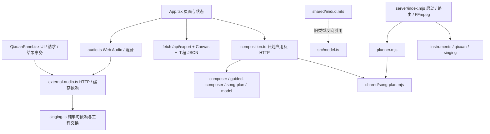

<a id="scroll-transition-discs"></a>

## 2026-11-08 滚动转场改回圆形

关联：[工单 29](../CC-Tasks/29-five-chapter-scroll-transitions.md)、[转场组件](../src/components/ChapterActs.tsx)。toge 反馈横向色带「没有重心、像塑料」：第一段改回从底部中间依次升起长大的五个圆，紫圆即幕布，向下拉开时露出圆弧边；工作台 → Let's 的入场也改为四个圆，黄圆盖满后文字弹入。Let's → MV（色块撑满后拉开）按要求不变。圆在舞台钉住前可越过上一页，但不接收点击；舞台背景延续首页点点纸 / 工作台格纸。Music Blocks 拼好后的停留约半屏滚动距离，短于原五圆版的约一屏，未调整。

验证：tsc、build 通过；`tests/chapter-motion.test.ts` 4/4；Mock 页面回归（`CHOKIDAR_USEPOLLING=true`）**35/35**。按 toge 要求本轮未再截图或测帧，未做人工滚动验收；无跨端交接。

<a id="five-chapter-scroll-transitions"></a>

## 2026-11-08 五章节滚动转场：幕布揭开与 Let's 文字翻转

关联：[工单 29](../CC-Tasks/29-five-chapter-scroll-transitions.md)、[原型接线边界](ARCHITECTURE.md#prototype-frontend)、[转场组件](../src/components/ChapterActs.tsx)、[计时函数](../src/components/chapter-motion.ts)。按 toge 要求把首页 → 工作台 → MV 改成五个全屏章节，取代原五圆过渡（ChapterBridge 已删除）；上次被回退的 43359f7 的问题（遮罩盖住内容、加空白、全宽板条加模糊导致卡顿）作为约束。

实现：两段过渡各是一条高轨道，画面 sticky 固定；后一章节包在 `.act-pin` 里，被拉到画面下方并在最后约一屏内钉住，幕布向下拉开时它原地不动，拉开后不留覆盖层，也没有给内容加空白。第一段黄/橙/紫三层纸错层升起，Music 字母与 Blocks 积木分拍入场，紫色前景幕布向下拉开露出工作台；工作台背景改为与幕布同色系的淡紫 4×4 切割垫网格。第二段同样三层纸升起，「go together」逐字鼓式翻滚（模糊、放大、下落、压扁回弹）成「make a music video」，色块右边缘跟随实际在场的字母伸缩并由薄荷绿变紫，再吞下「Let's」收拢整句、撑满全屏，最后像第一段一样向下拉开露出 MV。翻转用自带时钟播放，阈值带防抖，滚动过远时强制完成或复位，往回滚倒放。导航与键盘焦点直接到幕布拉开的位置；减少动态效果下两段是普通流中的静止标题页。

过程中修掉的问题：sticky 不进入父元素内边距（钉住距离改用 `::after` 占位块）；MV 自身的 `position:relative` 覆盖 sticky；窄屏下 100px 基准测量被屏幕宽度截断、字母边缘被重复缩放；首页视差会把首页底部按钮压到纸层下（已去掉视差，首页不做任何变换）；过渡轨道透明容器在幕布拉开后仍挡住工作台和 MV 的点击（轨道改为不接收点击，只有色块接收）；幕布拉开后标题下 8 个小方块仍在后台无限闪烁，CPU 紧张时拖慢整页（TAP 计时用例在文件轮询下 3/3 失败），改为只在标题页可见时闪烁后 3/3 通过。

验证：`npx tsc --noEmit` 与 `npm run build` 通过（仅既有大 chunk 提示）；`npx tsx --test tests/chapter-motion.test.ts` **4/4**；Mock 页面回归（`CHOKIDAR_USEPOLLING=true`）**35/35** 通过，其中 4 个用例改为先从导航进入工作台（工作台第一屏在幕布拉开前位于幕布下，Playwright 自动滚动会落在幕布下），章节用例改为检查两段过渡的状态与倒放复位。Playwright 无头 Chromium 逐帧截图检查 1280×800 与 390×844 两段全过程、翻转中间帧、反向倒放、减少动态效果。最终代码下真实滚轮连续从顶滚到底再滚回顶：1280×800 共 521 帧、1024×768 共 566 帧，中位 16.7ms，各有约 15 帧为 33ms（单次掉一帧，无帧超过 50ms）；390×844 共 607 帧无掉帧；无页面错误，回到顶部后翻转状态复位。

未完成：桌面尺寸的掉帧集中在工作台露出及之后一段（每次滚轮一格掉一帧）；对照实验中去掉网格背景或卡片投影都没有明显减少，原因未查清，本轮按 toge 要求停止排查，留待下次。无头浏览器是软件渲染，数字只作参考。未在 toge 可见的浏览器里人工连续滚动（本轮会话窗口未打开，预览面板处于后台），手感、停留距离与配色待 toge 核对；未动后端、契约、画面与导出链路，无跨端交接。

## 2026-11-08 积木按音符弹跳

关联：[工单 5](../CC-Tasks/5-toge-free-creation.md)、[首页](../src/App.tsx)、[动效计算](../src/components/board-pulse.ts)。原先播放游标让所有轨道同一列（含空格）整齐抬起；现改为当前实际音符起音触发、力度决定高度、短暂上升后衰减回落，折叠显示的其他小节音符不触发，静音轨道不动；减少动态偏好下改用描边。未更改音符、播放或音频链路，无跨端交接。

验证：六项定向断言通过（起音前、起音峰值、空格、跨小节、力度差异、衰减）；build 通过，保留既有依赖注释/chunk 提示。首轮 build 发现旧 current 变量引用，修正后通过。未做浏览器实际播放视觉验收或真实引擎测试；本轮仅本地提交。

## 2026-11-08 演唱卡片标题调整

关联：[工单 5](../CC-Tasks/5-toge-free-creation.md)、[首页源码](../src/App.tsx)。按 toge 要求将正式首页标题改为「今天使用什么演唱风格？」。仅修改展示文字，未改演唱逻辑；检查源码差异并通过 build，未做真实引擎或人工页面验收，无跨端交接。

<a id="lyrics-current-project-sync"></a>

## 2026-11-07 首屏改词同步便利贴与 MV

关联：[工单 5](../CC-Tasks/5-toge-free-creation.md)、[首页接线](ARCHITECTURE.md#production)。toge 确认改的是首屏铅笔中的歌词；原输入仅存于 useProduction 草稿，本地搭建又只传主题/风格，因此便利贴与 MV 继续读旧工程。

补「同步歌词到当前作品」与「用当前歌词填写」。同步维持当前作品句数，先检查全部改动，再一次发布工程；本地搭建同样带上草稿，将修改句标为手写，避免模板替换。自由作品复用既有等唱字数改词方法，保留音高/时值并同步 melodyDraft 文本与音节；字数不符、句/人声轨/相关音符锁定时保留原作品并提示。歌声不自动重制，改动句需重新演唱；兄弟句及伴奏保留。前端 Hook/组件完成，没有修改 shared、模型、Client、音乐核心或导出路径，无新增跨端交接。

验证：`npm run build` 通过（先修正前端 Note 到草稿的必填 syllable 类型，重跑通过）；`npx tsx --test tests/lyric-edit.test.ts tests/phrase-edit.test.ts` **9/9**；定向 Mock 页面 **5/5**，覆盖首屏同步、实际 Canvas.fillText 的新字幕、PV 导出请求新歌词、刷新保存、本地搭建使用输入、自由作品草稿一致与字数失败保护，以及既有本地创作/演唱/导出/五句自由制作回归。补强本地搭建的换风格场景后，构建及该用例再次通过：显式输入中与原文相同的未锁定句也标为 manual，换风格不覆盖这些句子。页面测试使用 `CHOKIDAR_USEPOLLING=true`，沿用既有 Windows 文件监听规避。Mock 导出仍是 JSON 回执；未调用真实 LLM/绮萱、未运行真实 FFmpeg 编码或人工听感验收，继续工单 6。构建仅有既有 Zod 注释与 chunk 提示。本轮本地提交，不推送、不重启服务。

<a id="frontend-interface-sync"></a>

## 2026-11-07 已交付接口前端补接

关联：[工单 27](../CC-Tasks/27-frontend-interface-sync.md)、[工单 5](../CC-Tasks/5-toge-free-creation.md)、[工单 15 P1](../CC-Tasks/后端/15-p0.md)、[工单 19](../CC-Tasks/后端/19-render-quality-and-artifacts.md)、[接口清单](INTERFACES.md)、[架构接线](ARCHITECTURE.md#performance)、[Client 授权与兼容](../shared/contracts/CHANGELOG.md)。基线 origin/main `101867d`，本地分支 `feature/frontend-interface-sync`。此前 Git 快进只证明代码一致，未证明新增能力已接页面；本轮核实 P0/P1 高级调教、产物/报告与可选 groove 确有前端缺口。

本轮完成：默认折叠的 Pitch 数值点/控制点预览、六项颤音、音素时序/发音、整句 DYN/表现曲线；capabilities 未报告或不支持时禁用相应控件。沿用既有单句渲染与三版调教历史，修改只使对应句演唱依赖失效；补历史演唱恢复按钮，依赖/runner 不匹配仍明确拒绝。整句 phonemes 平面列表仅展示原始参照，不伪造逐音符映射；没有拖拽曲线画笔。未改后端、音乐核心、工程模型或公开请求/响应 Schema。

toge 明确授权后补 Client 的只读产物/响度方法与兼容的导出报告回调。既有导出框可下载有效人声 WAV/USTX；FluidSynth 模式下明确点击准备当前器乐逐轨 WAV/MID。浏览器 synth 不自动切音源；没有整曲聚合 MIDI/ZIP。MP4 保持原 Blob 下载，显示 input/output/target；缺失或无效报告不丢已成功文件，null 不显示为零。工程变化后隐藏旧报告。Mock 产物与固定响度明确标注夹具。

验证：`npm run build` 通过；`npx tsx --test tests/performance-edit.test.ts tests/api.test.ts tests/p1-phoneme.test.ts` **20/20** 通过。6 项相关 Mock 页面用例分轮通过：原表达/失败保护、新高级调教、缺失能力、下载/响度失败保护、原混音 PCM/WAV/PV；补历史演唱恢复与中文校验提示后高级调教用例再次 **1/1** 通过，桌面/390px 无横向溢出并查看截图。真实模式导出 HTTP 夹具 **1/1** 通过（含响应头数值、null、缺失报告）；真实 FFmpeg **1 项跳过**：隔离服务没有可用 FFmpeg，PATH 与检查的常见安装位置未找到，不安装或伪造实测。没有重跑真实 LLM / 绮萱 / FluidSynth / DAW / 人工听感，继续[工单 6](../CC-Tasks/6-joint-acceptance.md)。

首轮 Mock 3 通过/3 失败：禁用 option 的断言方法不适用、模拟失败未恢复测试替身，以及 Vite 监听 Windows 下载 `.crdownload` 引发 EBUSY 后中断后续混音测试。修正两处测试并在单次命令设置 `CHOKIDAR_USEPOLLING=true`，受影响 3 项重跑全部通过；未改 Vite/Playwright 配置，也未隐藏失败证据。构建仍有既有 Zod 注释和大 chunk 提示。

前端交接 `15-P1-review` / `19-artifact-report` 已完成并从待交接移除，真实闭环仍由工单 6 维护。未完成的[可选 groove](../CROSS-END-HANDOFF.md#20-groove-render)、[synth 伴奏增益](../CROSS-END-HANDOFF.md#5-c-synth-mix)继续保留；长歌/专业和声/MixGraph 仍是待确认提案。另发现并复现[27-phoneme-zero](../CROSS-END-HANDOFF.md#27-phoneme-zero)：仅为第 0 音素设 offsetMs=0 时，核心会过滤该项并继续应用非零 consonantMs；前端传参未丢，已加限制说明并交红茶修复，未越界改算法。本轮只做本地提交，未推送或部署。

## 2026-11-07 管理脚本中断与保存校验修复

[工单 26](../CC-Tasks/已完成/26-admin-model-discovery.md)后续修复。修正路由表单插入节点错误，避免初始化中断导致按钮无响应；routeKeys 改为可选任务集合，修复空集合或只填单个任务时保存失败。真实 Chromium 管理 E2E 1/1 通过：保存 DPAPI 配置、清空密钥输入、HTTP 夹具连接测试、刷新脱敏和无页面异常；不代表真实厂商调用验收。

## 2026-11-07 资源台模型发现

[工单 26](../CC-Tasks/已完成/26-admin-model-discovery.md)，[使用说明](ENGINES.md#管理调试启动与路由)。连接表单移至资源台，显示当前三任务路由，支持用未保存或已保存密钥获取兼容模型列表并选择。管理/路由测试与 build 通过；模型发现使用 HTTP 夹具，未验证真实厂商或人工浏览器交互，无跨端交接。

## 2026-11-07 管理启动端口复用修复

[工单 25](../CC-Tasks/已完成/25-admin-routing.md)后续修复；[启动说明](ENGINES.md#管理调试启动与路由)。管理启动器核对现有服务项目根目录后复用，保留其他进程和检查模式的占用报错；不停止进程。静态语法检查通过，未执行真实浏览器打开验收。

# 2026-11-07 管理启动与模型路由

[工单 25](../CC-Tasks/已完成/25-admin-routing.md)；[使用说明](ENGINES.md#管理调试启动与路由)。新增管理启动 bat，三任务路由表单及独立 DPAPI 密钥保存。build 通过；管理与路由测试 12/12（含真实 Windows DPAPI）。未调用真实模型，未完成人工浏览器交互验收；无跨端交接。

# SONGYU 迭代日志

<a id="pr11-integration"></a>

## 2026-11-07 · 前端 PR #11 合并回归

- 工单：[5 · 前端接线](../CC-Tasks/5-toge-free-creation.md)、[23 · 三个视觉章节](../CC-Tasks/23-three-chapter-page.md)；说明：[原型接线](ARCHITECTURE.md#prototype-frontend)、[参数边界](INTERFACES.md)；交付：[PR #11](https://github.com/cicikat/CantaLoom/pull/11)。用户确认保留页面设计及双方文档，授权解决冲突、验证并合并。
- 整合 main `a0cc4db` 与前端 `ad0ef35`：README 保留后端 19–22 和前端 5/23；交接保留 5-C-synth-mix 与 main 最新状态；接口保留两侧能力与 Mock 限制；迭代日志保留全部历史。启动器临时路径在 main 已修复，直接沿用，无需重复改代码。
- 本机验证：build 通过（既有 Zod 注释与大包提示保留）；npm test（SONGYU_REAL_TESTS=0）101 项，97 通过、4 跳过、0 失败；Mock 页面全套 29/29；真实模式本地页面 studio/plan/launch 排除 FFmpeg exports 后 10/10。页面输出在 temp/pr11-mock/ 与 temp/pr11-real-pages/，CHOKIDAR_USEPOLLING=true；本地文档链接目标和 git diff --check 通过。
- 边界：本轮未做真实 LLM/绮萱制作、真实 MP4、手机实机/Safari 或人工听感验收；工单 6 与既有跨端待办继续保留。用户已确认页面设计，Toge 实机动效核对仍按原工单跟踪。远端 CI 与最终合并结果见 PR Checks 和合并事件。

<a id="three-chapter-page"></a>

## 2026-11-07 · 首页三个视觉章节、入场动效与竖屏版式

- 工单：[23 · 首页三个视觉章节与竖屏版式](../CC-Tasks/23-three-chapter-page.md)；说明：[原型接线边界](ARCHITECTURE.md#prototype-frontend)。toge 明确要求把单页重构为三个可连续滚动的视觉章节并顺带调整竖屏与紧凑区域。分支 `feature/frontend-three-chapters` 从 `feature/frontend-free-creation-mock`（14c965a，LOOP! 前端尚未进 main）开出。仅改前端页面、样式、页面测试与文档；未改后端、音乐算法、共享契约、Client、`src/visual.ts` 或导出链路。
- 第一章：首屏至少占满一屏，内容垂直居中、标题与插图加大。`HeroTitle` 给读屏一份完整标题，动画字母对读屏隐藏；`src/chapters.css` 以 `--beat: .14s` 让左右元素交替入场（眼眉贴纸 → 右上贴纸 → 「敲一下。」敲章式落下 → 插图摆入 → 逐字 → 圆点/星芒穿插 → 下划线 → 说明 → 输入 → 主题按钮），「变成一首歌！」每个字由旋转的黄色十字星星弹出、向右溅出三片碎片后回稳，约 2.2 秒后输入框就位。
- 第二章：`ChapterBridge` 是首屏后的 280svh 滚动区，向上叠住首屏最后一屏，内部画面粘在视口；滚动进度写入 `--p`，五个彩色大圆依次向上升起盖住首屏，最后一圈淡紫色铺满后显示 `Music Blocks`（白描字 + 六块彩色积木字母 + 八格步进灯），停留约一屏滚动距离，再接同色的工作台。过渡层 `aria-hidden`、不接收点击；`.page` 改用 `overflow: clip` 以保证粘性定位。工作台（积木、TAP、歌姬、歌词、混音）改在淡紫点阵背景上，加大章节留白，卡片在支持滚动时间线的浏览器里随滚动升起。
- 第三章：原 PV 弹层改为页面内深色章节 `#pv`（区域名「歌词 PV」）：走马灯、胶片框画面、播放按钮与时间、独立「PV 进度」条、字幕样式/换色/导出 MP4 与说明；导航「PV ✦」滚动到该章，导出状态改由全局提示条显示。原结尾横幅并入本章标题，弹层与横幅的旧样式已删除；导出作品弹层不变。
- 竖屏与紧凑区域：手机导航不再逐字折行（隐藏 logo 小字、按钮不换行）；≤900px 首屏单列且插图区限宽，贴纸跟插图成组；≤560px 歌词卡单列；MV 页在平板/手机纵向排列；歌姬卡小标题与 TAP 卡统一。最后一圈在高窄屏露出底边弧线的问题已按屏高放大半径修正。系统「减少动态效果」时关闭全部入场与滚动编排，过渡章为静态纯色标题块。
- 视觉检查（Mock，Playwright 截图，未入库）：桌面 1440×900 逐帧冻结检查入场节拍与逐字星星/碎片，滚动 8 个位置检查圆圈上升、纯色停留与工作台衔接；平板 768×1024、手机 390×844 检查三章与横向无溢出；减少动态效果模式检查静态版。浏览器控制台无错误。尚未经 toge 肉眼/真机核对动效节奏与停留距离。
- 测试：`npm run build` 通过（保留原有大包提示）。页面测试改动：PV 用例改为检查页面章节、同一时钟与 PV 进度条，不再测 PV 弹层的 Escape/焦点返回（导出弹层仍测）；版式用例由「首屏高度/积木起点与原稿相差 ≤2px」改为三章顺序、首屏占满一屏、过渡在滚动中铺满并出标题，歌词卡高度仍不超过原稿 +8px；`studio.spec.ts` 删去关闭 PV 一步。
- 测试稳定性：首轮全套有 3 项 A2 失败，原因都是测试在异步环境检查完成前点击「一键开工」，页面按 e237ddf 的设计打开了设置面板。对照实验：同一代码 A2 组重复 3 次，关闭动画 3/33 失败、开启动画 9/33 失败——竞态早已存在，入场动画加重了页面加载、扩大了时间窗口。已把文件里已有的「等按钮 title 消失再点」写法提为 `startMaking` 并用于 8 处点击，修后开启动画 A2 组 **33/33**。另：Windows 下 Vite 监听测试下载临时文件会 EBUSY 崩溃，测试命令沿用 `CHOKIDAR_USEPOLLING=true`。
- 最终结果：Mock 全套 **29/29**（输出 `temp/three-chapter-mock-final/`）；真实模式本地页面 `studio.spec.ts plan.spec.ts launch.spec.ts --grep-invert 'FFmpeg exports'` **10/10**（`temp/three-chapter-real/`）。未运行单元测试（未改其覆盖的模块）、真实 LLM/声库/FluidSynth/FFmpeg 导出、手机实机或 Safari；工单 6 不受影响、仍未验收。仅本地提交，未推送。

<a id="expression-mix-controls"></a>

## 2026-11-07 · 每句演唱调教与现有混音控件接线

- 工单：[5 C](../CC-Tasks/5-toge-free-creation.md)；说明：[调教与混音接入](ARCHITECTURE.md#performance)、[前端参数速读](INTERFACES.md#前端速读哪些数字需要做成控件)。toge 在参数说明后要求实施，并明确选择「只接前端，核心问题交接红茶」。沿用 LOOP! 原版首屏、卡片与字体/颜色，只增加按需展开的控件；未修改后端、音乐算法、公共契约、Client、统一混音或导出算法。
- 实现：`PerformanceControls` 接自然/轻柔/强烈、Auto/Manual、句级四项参数、逐音符人工覆盖/锁定、句级表达锁、最多三版恢复；复用 `setPhrasePerformance` / `autoTuneProject` / `restorePerformance`。数值边界直接读取共享 Schema。保留既有 Pitch 曲线，显式清除音符覆盖时才清除所选整项。表达修改仅失效目标句，通过原 QixuanPanel 重新演唱；不调 LLM/旋律接口，不清空兄弟句与器乐资产，重唱失败保留旧资产。元音演示不冒充支持真实调教，相关控件禁用。
- 混音：`MixControls` 写入既有 mixSettings，`usePlayer` 透传现有 stem 并从头试听；干人声、处理人声、伴奏、全混音均接通，改参数停止旧声音。人声音量/混响仅在 external 启用；伴奏音量仅在 fluidsynth 启用。浏览器 synth 尚未应用 bandGain，禁用并解释，已登记 [5-C-synth-mix](../CROSS-END-HANDOFF.md#5-c-synth-mix) 交红茶；未擅改 audio.ts。表达锁元数据仍进入既有演唱依赖，切换后可能提示重唱，按既有保守校验处理。
- 构建与定向测试：`npm run build` 通过（保留依赖注释及大包提示）；`npx tsx --test tests/performance-edit.test.ts tests/melody.test.ts tests/p0-tuning.test.ts tests/mock-free.test.ts tests/phrase-edit.test.ts` **31/31** 通过。覆盖非法/非有限数值原子拒绝、Pitch/兄弟句/音符保留、锁定与自动保护、三版历史及既有局部编辑/来源隔离。
- Mock 页面：新增三项调教/混音用例通过；全套 **29 项已逐项通过**：首次全套 28 通过，旧 A2 迟到响应测试因抢在环境就绪前点击而失败，补就绪等待后该项定向复测通过，未把首次全套写成全绿。全套输出 `temp/expression-mix-regression/`，复测 `temp/expression-mix-a2-recheck/`。断言单句重唱调用范围、失败保留、锁定/历史/重载，四种 stem 实际进入播放器；渲染实测人声音量归零使 processed 静音、dry 非静音，混响 0→0.12 改变 PCM；FluidSynth Mock 双路归零后，下载 WAV 的 PCM 与送往 PV 的 WAV 均静音，不只检查 JSON 值。
- 环境与版式：首轮页面测试遇 Windows Vite watch 下载 `.crdownload` 的 EBUSY，测试命令仅增加 `CHOKIDAR_USEPOLLING=true` 后完成，未改 Vite 配置或杀其他服务。新增下拉框补明确的可访问名称。既有首屏/卡片几何回归通过；390px 无横向溢出，已检查截图 `temp/songyu-expression-desktop.png`、`temp/songyu-expression-mobile.png`，混音截图 `temp/songyu-expression-mix-mobile.png`。
- 真实模式本地页面：`npm run test:e2e -- studio.spec.ts plan.spec.ts launch.spec.ts --grep-invert 'FFmpeg exports' --output temp/expression-mix-real-mode` **10/10** 通过；包含本地合成 PCM、保存/锁定/字幕/播放、缺项说明及接口夹具，未运行真实 LLM/声库/FluidSynth/FFmpeg 编码或手机/Safari。本轮 PV 是 Mock JSON 回执，测试音不代表实际歌声或人工听感；工单 6 保持未验收。本轮仅本地提交，不推送。

<a id="quality-interface-delivery"></a>

## 2026-11-07 · 工单 19/20 接口标注与协作交付

关联：[工单 19](../CC-Tasks/后端/19-render-quality-and-artifacts.md)、[工单 20](../CC-Tasks/后端/20-groove-and-humanization.md)、[接口清单](INTERFACES.md)、[契约记录](../shared/contracts/CHANGELOG.md)。

按用户要求在 INTERFACES 明确标注「新增」：artifact 下载与分轨 loudness 端点、48kHz 响应、MP4 X-Songyu-Loudness 头、groove 字段及保护标记；列出默认值、错误码、种子/缓存语义、示例和当前 Client/Mock/UI 接线边界。同步纠正 P1 已合并和已有 compose/melody/production Mock 的过期表述；用户不可调 LUFS 目标与服务端固定归一区分说明。

工作区原有唯一未提交代码为 src/api/mock.ts 的 sampleRate 24000→48000 单行修改，本轮按用户「确保工作区干净后 push 并合并」的交付范围纳入提交，仅与工单 19 的响应契约保持兼容，不扩展前端功能。此前后端核心全量 98/99（1 项真实 LLM 跳过）、最终定向 30/30、真实 FluidSynth/Chromium WAV/MP4 结果见上两条记录。当前 main 分支保护查询返回 Branch not protected（404），不据此跳过 CI。本轮 Mock 浏览器回归 26/26 通过（1.9 分钟），INTERFACES 本地链接目标检查和 git diff --check 通过。

本轮授权推送 feature/backend-music-quality-tickets 并经 [PR #10](https://github.com/cicikat/CantaLoom/pull/10) 合并 main；分支已推送，提交时工作区干净。CI 与最终合并记录以该 PR 的 Checks/合并事件为准（GitHub 连接器写入返回 403，改用本机已认证 CLI 创建 PR）。人工听评、DAW 抽验和可选 groove 页面接线仍未完成，原工单与交接保留。


<a id="groove-humanization-20"></a>

## 2026-11-07 · 工单 20 鼓组与确定性律动

关联：[工单 20](../CC-Tasks/后端/20-groove-and-humanization.md)、[律动接入](ARCHITECTURE.md#groove-render)、[契约变更](../shared/contracts/CHANGELOG.md)、[交接 20-groove-render](../CROSS-END-HANDOFF.md#20-groove-render)。

自由模式新增 2/4 backbeat、energy 三档鼓型/末小节 fill、强弱踩镲，去掉原统一 `.5+energy*.5` 映射，保留 TAP kick 与关闭补全。可选器乐 groove 用工程 ID / 轨道 ID / version / 参数种子，只在 MIDI tick 层施加 swing 与非鼓 timing/velocity 抖动；整数/幅度约束经 Zod 校验、声明同步，参数进入缓存 hash，revision=3。锁定/手写/单音符锁定整轨旁路，hash 前去掉 groove，实际保护轨缓存键不随开关变化。旧模式已有 backbeat/TAP，决定不重构；未修改 UI/Mock/Client/工程 Schema/SongPlan。

本机 Windows 真实 FluidSynth/现有 SoundFont：新增定向测试 4/4 通过，无跳过；独立解码 MIDI 事件断言 swingTicks=60 后 onset 为 0/300/480/780/960/1260/1440/1740，同输入字节一致；保护、TAP 补全关闭、energy 事件差异、真实 PCM 差异/缓存命中均通过。对照音保留 `temp/task20/variant-0..3.wav`，分别为直拍器乐、律动器乐、低能量鼓与高能量鼓，不提交音频。

build 通过（保留既有 Zod 注释/bundle 体积提示）；npm test 99 项，98 通过、0 失败、1 跳过（未启用真实 LLM 路由）。其后补齐受保护轨 hash 归一，并重跑包含真实保护轨缓存的定向测试通过；最终核心/API/自由作曲/production/计划保护共 30 项定向回归全部通过。`node scripts/verify-render-quality.mjs --free` 以本地规则生成自由编曲，通过 Chromium 的现有 renderAudio/wavBlob、真实 FluidSynth 与 MP4 链路；混音 RMS 0.034584、24kHz，输入 -25.7 LUFS / -9.5 dBTP，最终 AAC -13.6 LUFS / -1.4 dBTP，沿用工单 19 的如实报告目标差距。输出/报告与日志均在 `temp/task20/` 或 `temp/task20-*.log`；git diff --check 通过。

本轮没有真实 LLM 新创作、人工抽听、正式 UI 律动开关或手机/Safari 验收。自由鼓组/energy 默认进入现有核心；可选 groove 尚未由浏览器/production 默认携带，统一保存/预览/导出来源交给 Toge 确认后接线，未将 API 完成称为页面完成。工单实施项完成，人工听感待验，保留原位。沿用 feature/backend-music-quality-tickets，本轮本地提交，不推送；已有 src/api/mock.ts 改动保留、不暂存。


<a id="render-quality-19"></a>

## 2026-11-07 · 工单 19 渲染与产物后端交付

关联：[工单 19](../CC-Tasks/后端/19-render-quality-and-artifacts.md)、[接入说明](ARCHITECTURE.md#创作产物与响度报告工单-19)、[契约](../shared/contracts/CHANGELOG.md)、[交接 19-artifact-report](iteration-log.md#frontend-interface-sync)。

本轮接续工作区已有 48kHz/产物端点修改，完成 PCM s16/revision=2、MIDI/USTX/WAV 原字节下载与非法路径拒绝、只读分轨 ebur128 测量、MP4 loudnorm 和最终 AAC 测量报告；保留 MP4 二进制响应，新增 X-Songyu-Loudness 头。逐轨下载零依赖，决定暂不提供 zip。s24 缺少跨浏览器证据，按工单保留 s16。未代改 UI/Client/Mock。

Windows 本机真实 FluidSynth、现有 SoundFont、FFmpeg（本机配置）和 Chromium：新增 3 项回归全部通过，无跳过；build 通过（保留 Zod 注释及 bundle 体积提示）；npm test 共 95 项，94 通过、0 失败、1 跳过（真实 LLM 路由未启用）。包含既有人声真实引擎回归，但不表示本轮重新验收模型/页面创作。git diff --check 通过。

合成正弦夹具 -41.7 → -14.0 LUFS，最终 AAC TP -10.2 dBTP。`node scripts/verify-render-quality.mjs` 另以真实 FluidSynth 源文件经 Chromium 原有 renderAudio/wavBlob 全曲混音、WAV 和 MP4 导出通过；RMS 0.031404，浏览器混音仍 24kHz。最终 MP4 输入 -26.4 LUFS / -13.0 dBTP，输出 -13.6 LUFS / -1.3 dBTP，距 -14 / -1.5 目标分别 +0.4 LU / +0.2 dB，未宣称严格达标。媒体与报告位于 `temp/task19/`，测试日志在 `temp/task19-tests.log`，均不提交。此轮没有从正式 UI 现场输入新主题制作，也没有人工听评、DAW 打开或手机/Safari 实测。

实施 checkbox 已更新，因 DAW 人工抽验/共同听感未完成，工单保留原位待验收。下载/报告页面接入登记交接 19-artifact-report。现有前端 Mock 采样率改动保留在工作区，不纳入本轮提交。分支沿用 feature/backend-music-quality-tickets；仅本地提交，不推送。


唯一完成记录入口。新条目放在最上方，按日期倒序；同日新记录在前。每条写明工单与相关文档地址、实际实现、验证结果和未验收边界；状态 checkbox 只维护在对应工单。

以下历史证据由原 ACCEPTANCE.md、V021_ACCEPTANCE.md、V031_BACKEND_ACCEPTANCE.md、V032_BACKEND_ACCEPTANCE.md 合并，保留原执行结果与限制。它们不表示当前电脑刚通过测试。旧记录中的当时工作流或待办仅作历史；现行规则见 [AGENTS](../AGENTS.md)与[团队工作流](TEAM_WORKFLOW.md)，当前任务从 [README](../README.md#协作工单)进入。

<a id="backend-music-review-tickets"></a>

## 2026-11-07 · 专业音乐人视角后端评审与四张新工单

- 工单：新建 [19 · 渲染音质与创作产物导出](../CC-Tasks/后端/19-render-quality-and-artifacts.md)、[20 · 鼓组律动与演奏人性化](../CC-Tasks/后端/20-groove-and-humanization.md)、[21 · 和声、声部连接与拍号速度](../CC-Tasks/后端/21-harmony-voice-leading-form.md)、[22 · 制作后端治理](../CC-Tasks/后端/22-backend-production-ops.md)；关联 [15 P2-A/P3](../CC-Tasks/后端/15-p0.md) 与 [12 · 后台待排期](../CC-Tasks/12-admin-backlog.md)；交接：[21-harmony-contracts](../CROSS-END-HANDOFF.md#21-harmony-contracts)。
- 评审：以专业制作用户视角通读 server/ 与 shared/ 生成渲染链路。结论摘要：工程侧严谨（契约校验、缓存完整性、密钥与失败保护），音乐侧薄弱——和声为 4 个级内三和弦循环且无转位/voice leading、贝斯恒根音、鼓无 backbeat/fill 且全事件落网格、FluidSynth 24kHz 单 SF2 干声、已生成的 MIDI/USTX/分轨不提供下载、导出无响度归一。
- 落单：P0 快赢（48kHz、产物下载、loudnorm、LUFS 测量）→ 19；鼓组律动与确定性人性化 → 20；和声/经过音/voice leading/贝斯织体/拍号速度 → 21（契约提案，待授权，依赖 15-P2A-contracts 一并评审）；缓存配额/任务持久化/渲染并发池 → 22（领取工单 12 第 1/3 项）。混音效果链与分轨混音仍归 15 P3，长歌曲式仍归 15 P2-A，新工单未复制其 checkbox。
- 验证：纯文档任务，仅检查本轮 Markdown 本地链接、README 索引一致性与 Git diff；未运行构建、LLM 或真实引擎测试，不改变任何既有验收状态。本轮仅本地提交，未推送。

<a id="backend-p1-p2b-publish"></a>

## 2026-11-07 · 交付 P1/P2-B 并修复启动测试临时路径

- 工单：[15 · 后端升级](../CC-Tasks/后端/15-p0.md)、[16 · 启动入口](../CC-Tasks/已完成/16-easy-launch.md)；接入：[任务路由](ARCHITECTURE.md#task-routing)、[后台配置](ENGINES.md#llm-routing)；交接：[跨端清单](../CROSS-END-HANDOFF.md)。用户明确要求将剩余完成成果推送并直接合并，更新此前整单完成才 PR 的交付安排；P2-A/P3 未确认的跨层范围继续保留，不把该指令扩大为新跨区实施授权。
- 交付：[后端 PR #9](https://github.com/cicikat/CantaLoom/pull/9)，推送 feature/backend-p1-phoneme 的 P1 音素/表现参数与 P2-B LLM 三任务路由。整合 main 7bee0eb，README 保留后端能力状态与最新 LOOP 前端进度，迭代日志保留双方全部历史记录；契约自动合并后通过构建和单元回归，未改动前端实现。
- 路径修复：tests/launcher.test.mjs 移除写死的其他电脑临时路径，依据 import.meta.url 定位项目根目录，先建 temp/ 再 mkdtemp，并由 t.after 清理本次夹具；路由配置测试也从 .local 改用项目 temp/。启动器单项 1/1 通过；在全新含空格目录、缺少 temp 父目录且 cwd 不同的隔离环境运行同一测试，1/1 通过并验证清理。证据在本机 temp/launcher-portability-result.json。
- 验证：整合后 build 通过（保留既有 Zod 注释与 bundle 大小警告）；npm test（SONGYU_REAL_TESTS=0）92 项，89 通过、3 跳过。单独真实绮萱 P0/P1 两项回归 2/2 通过（234.2 秒），覆盖真实 WAV 差异、缓存精准失效与原子文件；输出见本机 temp/backend-p1-p2b-real-audio.log。本轮没有重新调用真实 LLM，路由真实双模型 ID 证据沿用前一轮并保留其日期和边界。
- 页面边界：Mock 首跑 25 通过/1 失败，真实 HTTP/页面筛选套件首跑 12 通过/1 失败。高负载 TAP 时间断言在未改动 main 基线也失败；音频任务结束后串行重跑两项均 1/1 通过。不能写成整套首跑全绿；具体错误、基线与重跑日志在 temp/，稳定性问题登记 [5-browser-timing](../CROSS-END-HANDOFF.md#5-browser-timing) 由 Toge 核对，未顺手修改前端用例。
- 保全：此前 17 个未提交草稿仍保留在 stash 65cc8c0dc1ad9dd80eddf85a9add6bb4deb3a11b 与 backup/cross-end-handoff-2026-11-07/，不混入稳定后端交付。按用户授权提交后端 PR 并直接合入 main；PR/合并结果通过 Git 历史与 PR 入口核对，工作区不恢复草稿。

<a id="cross-end-handoff"></a>

## 2026-11-07 · 根目录跨端交接与按需上下文

- 工单：[18 · 跨端交接文档](../CC-Tasks/已完成/18-cross-end-handoff.md)；入口：[CROSS-END-HANDOFF.md](../CROSS-END-HANDOFF.md)；规则：[AGENTS](../AGENTS.md#project-workflow)、[团队工作流](TEAM_WORKFLOW.md#跨端交接登记)。按用户要求，在发现需对方接手/确认/联调时由 Agent 随本轮工作自动登记，原工单只留 ID 和链接；完成后将正式结果写回原工单/日志，默认删除交接项，必要时短暂标记已完成并附日期、证据。
- 上下文边界：AGENTS 只保留短规则和入口；交接正文不列为启动必读、不全文自动注入，只在当前任务相关时按工单号/接收方/模块检索。当前登记工单 15 的 P1 review、P2-A 契约、P2-B 路由交付及 P3 MixGraph 四项，注明本地分支成果未在 main 发布；未把已完成的前端 Mock 工作重新列为缺口，也未给待确认跨层代码追加授权。
- Git 与保全：本次文档任务从核对后的 origin/main 55d5810 建 feature/backend-cross-end-handoff；已有后端提交保留在本地 feature/backend-p1-phoneme（9718420）。17 个既有未提交文件保存在本地 stash 65cc8c0dc1ad9dd80eddf85a9add6bb4deb3a11b；另将原始字节、清单与补丁保存在 Git 忽略的 backup/cross-end-handoff-2026-11-07/，17/17 SHA-256 与封存前一致。stash/backup 仅在本机，不随 PR 上传。
- 恢复入口：确认工作区干净后切回 feature/backend-p1-phoneme，再运行 git stash apply 65cc8c0dc1ad9dd80eddf85a9add6bb4deb3a11b；apply 保留 stash，便于核对。原始字节备份可用于核对 Git 行尾规范化差异。不要在文档分支直接应用长歌草稿，不自动删除 stash 或备份。
- 验证：仅检查本轮 Markdown 的本地链接/锚点、文档一致性、Git diff 与文档提交范围；未运行构建、前端 E2E、LLM 或真实引擎，也未重宣称此前音频验收。本次按用户要求提交文档 PR，前一轮后端成果继续留在原分支，P2-A/P3 的跨端实施与整单验收仍待对方确认。

<a id="start-button-readiness"></a>

## 2026-11-07 · 一键开工可点击查看制作缺项

- 工单：[5 · 前端接线](../CC-Tasks/5-toge-free-creation.md)，入口：[README](../README.md#launch)，准备逻辑：[架构](ARCHITECTURE.md#launch)。toge 反馈「一键开工」无法点击；当前 3001 公共 API 报告 LLM 未配置、伴奏音源未就绪、绮萱不完整及 FFmpeg 未就绪。前端原先对任意缺项禁用按钮，而说明又放在隐藏面板里，导致缺乏可操作入口；API 状态不等同于全盘确认资源文件不存在。
- 修复仅在 PatchlabCreation：缺项时点击主按钮打开已有创作设置、聚焦入口并显示实际缺项；不提交制作、不自动切换 Mock 或旧模板。忙碌、任务运行及空主题仍禁用；资源就绪仍走原 useProduction。未改后端、配置或资源、未发起真实模型调用或增加常驻说明。
- 验证：`npm run build` 通过；launch 页面 **4/4**，输出 `temp/songyu-start-button-real`；Mock 五句制作→试听→恢复 **1/1**，输出 `temp/songyu-start-button-mock`。新增/更新断言覆盖缺项按钮可点击、面板可见、零提交，配置夹具就绪后正常提交且失败保留工程。本轮还直接在正在运行的 3001 构建页用隔离浏览器上下文点击主按钮，实际四项缺失信息可见、制作请求 0、页面异常 0，截图 `temp/songyu-start-button-actual.png`；没有使用测试能力响应替代这次实际检查。真实资源安装/配置和完整生成仍需后端工单 4 / 共同工单 6；仅本地提交，未推送。

<a id="loop-layout-restoration"></a>

## 2026-11-07 · 撤回接线时擅自增加的默认页面内容

- 工单：[5 · 原型接线](../CC-Tasks/5-toge-free-creation.md)，依据：toge 反馈接线改动了原交互并增加说明，使原本版式臃肿。入口：[README](../README.md#launch)，接入边界：[架构](ARCHITECTURE.md#prototype-frontend)。前一条接线虽然功能通过，但没有守住原稿的默认排版；本轮直接按原 HTML 对照收简，视觉仍待 toge 实际确认。
- 实际修改：去掉默认 Mock 横幅、制作便签/准备/来源说明、作品信息栏、额外段落栏、常驻配方/引擎/演唱折叠区，以及全宽底部悬浮播放器。输入框左侧原铅笔位置打开歌词/制作设置，初始主题沿用当前工程；右上角保存/导出菜单（手机 ⋯）承载保存、导出、引擎与方案。段落选择放在积木标题内，进度放在原积木底栏；单轨试听使用音轨图标。歌词卡片恢复正文加一个主按钮，单句试听/锁定收至角落；卷帘、重唱仍按需展开，实际制作状态仅在任务后出现。未改原始 HTML、后端、公开契约、音乐算法或导出实现，未清除工程或重启已有服务。
- 验证：`npm run build` 和 `node --import tsx --test tests/production-page.test.ts` **2/2** 通过；`CHOKIDAR_USEPOLLING=true` 下完整 Mock 页面 **26/26**，输出 `temp/songyu-loop-slim-mock`；launch / plan / studio（排除 FFmpeg）真实模式本地页面 **10/10**，最终输出 `temp/songyu-loop-slim-final-real`。两个播放断言首次在原 5 秒等待内未通过；定向诊断中浏览器音频恢复约 20ms、离线准备约 1.2–1.8 秒，未复现卡住，移除诊断并将断言改为按实际播放状态等待（上限 20 秒），最后完整 10 项通过；没有改音频算法，不能把一次失败归为已确认的性能根因。测试继续覆盖本地 PCM / WAV、Mock 制作和回执、失败保留、锁定、排序、导入、卷帘与局部重唱。
- 原稿对照：页面测试在同一 1440px 视口读取原 HTML（仅在测试 DOM 移去入口提示），首屏高度、积木起点差异 ≤2px，歌词卡片高度不超过原稿 +8px。390px 无横向溢出；原稿与收简后的截图分别为 `temp/songyu-loop-original-layout.png`、`temp/songyu-loop-restored-desktop.png`、`temp/songyu-loop-restored-mobile.png`，已检查。实际工程保留六类音轨，较原稿五条演示轨多出真实和弦轨，没有用隐藏工程数据来压缩页面。真实 LLM、声库与 MP4 编码未运行，人工视觉/听感不提前验收；本轮仅本地提交，未推送。

<a id="loop-prototype-wiring"></a>

## 2026-11-07 · 按 LOOP! 原型重做正式首页接线

- 工单：[5 · 原型接线](../CC-Tasks/5-toge-free-creation.md)；接入：[架构](ARCHITECTURE.md#prototype-frontend)，入口：[README](../README.md#launch)，后续真实验收：[工单 6](../CC-Tasks/6-joint-acceptance.md)。toge 明确要求删掉当前接线，重新接入 `03_patchlab_playful.html`。App 替换四页工作台入口，main 停用 style.css / plan.css，patchlab.css 提取原型样式并补实际控件；HTML 保留原始设计和演示交互，横幅改为正式入口说明。未清空工程、清理历史源码、改后端/共享契约/音乐算法或重启已有服务。
- 实际结果：首屏复用 useProduction 的主题/可选 1–8 行歌词、任务阶段、取消、失败保留、单句重试；四个主题按钮填意图。积木读取实际工程音轨，格子、静音、锁定、单轨试听、重做、拖动和 ↑↓ 写回工程；TAP 记录真实时间。歌词按实际数量展示，自由作品由卡片展开对应句 PianoRoll / usePhraseEditor，逐句演唱复用 QixuanPanel。PV Canvas、播放器、WAV/PV 导出共用现有时钟与链路；字幕样式/配色、工程导入/保存实际生效；dialog 支持 Escape 和焦点返回。原型随机换词、振荡器和独立字幕计时器未进入正式页。
- 验证：`npm run build` 通过；`node --import tsx --test tests/core.test.ts tests/phrase-edit.test.ts tests/mock-free.test.ts tests/production-page.test.ts tests/api.test.ts tests/launcher.test.mjs` **29/29**；`npm run test:e2e:mock -- --output=temp/songyu-loop-final-mock` **26/26**；`npm run test:e2e -- tests/browser/launch.spec.ts tests/browser/plan.spec.ts tests/browser/studio.spec.ts --grep-invert FFmpeg --output=temp/songyu-loop-real-page` **10/10**。页面测试按新入口迁移，保留旧断言的工程/资产保护目标，新增排序保存、导入还原、真实 TAP、PV Canvas 与工程时间对照、对应卡片选句、手机布局与弹层焦点验证。末次将导出进度与结果提示放进模态弹层后，再次构建并定向回归本地创作/导出及 TAP/PV/焦点 2/2 通过，输出在 `temp/songyu-loop-dialog`。桌面/390px 截图位于 `temp/songyu-loop-home-desktop.png`、`temp/songyu-loop-home-mobile.png`，已检查。
- 一次测试中 Windows 对 `.crdownload` 的文件锁触发 Vite EBUSY；最终页面验证在当前命令进程设置 `CHOKIDAR_USEPOLLING=true`，未改全局或项目配置。构建仍有依赖注释与较大 bundle 提示。真实模式测试包含本地 Web Audio PCM、WAV 及明确接口夹具，未调用真实 LLM / 绮萱 / FluidSynth、未运行真实 MP4 编码；Mock PV 是 JSON 回执。视觉确认、真实制作和人工听感未提前勾选，调教/混音控件仍是工单 5 后续。本轮仅本地提交，未推送。

<a id="project-local-artifacts"></a>

## 2026-11-07 · 临时产物与备份归入项目目录

- 工单：[17 · 项目内临时产物与备份归位](../CC-Tasks/已完成/17-project-local-artifacts.md)；规则：[AGENTS](../AGENTS.md#project-workflow)，入口：[README](../README.md#架构与数据)，验证输出约定：[ARCHITECTURE](ARCHITECTURE.md#mock)。按 toge 要求，检查 11 月 6–7 日的全局 temp / backups，将确认属于 SONGYU 的现存产物移入项目根目录 `temp/`，本机备份使用 `backup/`。目录内容由 Git 忽略，保留本机文件。
- 实际迁移 9 项、11 个文件、1,471,034 字节：`songyu-launcher-80IGB4/`、`songyu-launcher-iIvtH4/`、`songyu-push-merge-launch/`、`songyu-push-merge-mock/`，以及 `songyu-a2-desktop.png`、`songyu-a2-mobile.png`、`songyu-c-piano-desktop.png`、`songyu-c-piano-mobile.png`、`songyu-launch-setup.png`。均为 11 月 7 日产物；全局 backups 为空，没有发现 11 月 6 日的匹配项。迁移清单及逐文件 SHA-256 保留在本机 `temp/songyu-artifact-migration-2026-11-07.json`。
- 迁移前后逐文件 SHA-256 一致，原路径已移走，未覆盖目标或删除数据；同盘移动未释放磁盘空间。需要回退时可按清单移回原路径。两个 push-merge 输出目录仅有 `.last-run.json`，不宣称包含完整报告。此前日志提到的 A1 / A2 / C / launch 其他测试输出目录当前未找到，没有补造产物。
- 下方历史执行命令保留当时路径与结果；已迁移的四张 A2 / C 截图现位于本项目 `temp/` 同名文件，两个 push-merge 目录也位于本项目 `temp/`。这些路径变更不代表重跑历史验收。更新架构中的后续命令、README 和忽略规则；本轮仅检查迁移完整性、文档引用、Git 忽略规则及 diff，未运行构建、浏览器、真实模型或引擎，未推送远端。

<a id="prototype-direction-correction"></a>

## 2026-11-07 · 纠正原型用途与前端接线方向

- 工单：[5 · 原型方向更正](../CC-Tasks/5-toge-free-creation.md)、[6 · 原型真实验收](../CC-Tasks/6-joint-acceptance.md)；依据：toge 要求先更新文档，并反馈 Blacktea 喜欢、准备使用 LOOP! 原型。更正 [README](../README.md#launch)、[团队工作流](TEAM_WORKFLOW.md)、[架构边界](ARCHITECTURE.md#prototype-frontend)和[接口入口](INTERFACES.md)，以原型视觉与交互为前端接线基础，不再将另建的四页工作台视为默认替代设计。
- 源码核对：原型有灵感、TAP、积木、歌词卡和 PV 弹层；内部仍为随机格子/换词、简单振荡器与独立字幕计时。可保留其设计并复用现有工程、hooks、Client、播放器和导出能力；技术实现需要替换不等于设计需要废弃。当前 index → main → App 仍打开 React 四页工作台，原型没有完成这些能力的接线。
- 责任与历史边界：ca5773a 的初始 README 已将 HTML 定为视觉参考；b5e8e1a 的文档整理强化“不是当前应用入口”；2e3325a 在原型加提示并引导打开工作台。Git 署名不证明设计由署名本人提出或授权。当前可读的「查看下一步」聊天中，toge 要求接 A2/C 和方便交付，Agent 随后自行把原型保留作参考；这些要求不能作为换原型的授权。历史记录保留，在[工单 16](../CC-Tasks/已完成/16-easy-launch.md)增加更正，不改写当时测试结果。
- 本轮仅文档更正，未改 HTML 横幅、UI、启动器、后端、共享接口或存档；工单 5 新增原型接线待办，原有 React 接线 checkbox 保留并注明范围。验证为 Markdown 链接、锚点、内容与源码核对及 git diff --check；不运行构建、模型或浏览器测试。后续须在原型接线后重新核对视觉与功能，当前不宣称原型已可真实制作音乐。

<a id="frontend-main-integration"></a>

## 2026-11-07 · 前端工单 5 / 16 与最新 main 整合

- 工单：[5 · 自由创作页面与局部编辑](../CC-Tasks/5-toge-free-creation.md)、[16 · 日常启动入口](../CC-Tasks/已完成/16-easy-launch.md)；接口：[A1 / P0 兼容记录](../shared/contracts/CHANGELOG.md)。按 toge「推送」要求，合入远端 main 的后台与 P0 调教提交；README、架构与本日志保留双方新增内容，旋律声明同时保留 mock 标记与 Pitch 曲线导出，与已自动合并的运行时对应。未代改后端实现或扩展接口语义。
- 远端后台已占用工单 13，前端启动工单改为检查过当前文件与 Git 历史均未使用的 16，同步 README / 架构 / 日志引用；后台工单 13 保留。
- 合并后验证：npm run build 通过；相关边界与 P0 / 启动器单元测试 47/47；完整 Mock 页面 23/23；启动与准备状态页面 4/4。浏览器产物在仓库外 temp/songyu-push-merge-mock 与 temp/songyu-push-merge-launch；能力响应为明确夹具，没有运行真实模型、声库、MP4 或人工听感验收，工单 6 保持未验收。
- 保留原有 AGENTS.md 未提交改动，不纳入合并提交。按当前项目规则提交合并后更新远端 main；不部署、不重启已有服务。

<a id="easy-launch"></a>

## 2026-11-07 · 单一双击入口与制作前准备

- 工单：[16 · 方便使用的启动入口](../CC-Tasks/已完成/16-easy-launch.md)；日常使用：[README](../README.md#launch)；接线：[启动架构](ARCHITECTURE.md#launch)。toge 指出交付不应要求分辨原型和开发命令，本轮补使用入口，未修改后端、配置、共享契约或音乐算法。
- 根目录「打开声屿.bat」仅转交既有 start.bat，保留参数/退出码，使用原依赖检查、构建、启动和自动打开页面链路。本机桌面创建「声屿.lnk」，目标与工作目录核对正确，未覆盖已有快捷方式。旧 LOOP HTML 原型完整保留，增加设计参考提示与实际入口说明。
- 同轮收尾发现默认 3001 已有实际声屿服务运行；未关闭该进程，补充薄预检 helper，仅在 health、页面标识、资产路径与 JS 内容哈希匹配当前 dist 后复用并打开。不存在/不匹配则交回原 start.bat，check/no-open 不开浏览器。新增启动器测试 1/1 与语法检查通过，中文入口 --check 实际输出 reused current app；不再让重复打开进入端口占用错误。
- 制作页只读检查 health / engines / qixuan 的现有状态，缺项/失联时禁用自动制作提交，显示「打开本机设置」「重新检查」和直接可用的「先玩音乐积木」，缺项详情默认折叠。检查不调用模型、安装资源或写入配置，不伪造 verified，不自动回落 Mock；原有本地创作/试听和存档保留。
- 验证：构建通过；中文入口 `--check` 在默认真实服务链路通过，检查后正常退出。实际正式构建以临时同源 Node 服务和隔离 Chromium 完成本地灵感生成、播放状态/进度、缺项提交保护，页面错误 0，没有请求实际推理；只关闭本次验证创建的服务。`npm run test:e2e -- tests/browser/launch.spec.ts --output=D:/vibe-coding_/temp/songyu-launch-test-results` 4/4 通过（能力响应为明确测试夹具）；`npm run test:e2e:mock -- --output=D:/vibe-coding_/temp/songyu-launch-mock-regression --grep="frontend alone|A2 page makes|C targeted"` 3/3 通过，覆盖旧页、A2 与 C 代表性流程。启动器未改动，无需另造后端启动测试。
- 当前机器实际检查 LLM / 伴奏音源 / 中文演唱声库 / FFmpeg 均未就绪；本地规则创作和浏览器合成试听已实测可用。新启动入口不代表真实 AI 制作可用，资源与正式听感仍交接 [工单 4](../CC-Tasks/4-blacktea-integration.md) / [工单 6](../CC-Tasks/6-joint-acceptance.md)。临时截图/测试输出不作为长期交付资产；正式可重复验证在上述测试文件与入口中。
- 文档文件链接与 `git diff --check` 通过；工单 16 已完成并归档，代码/文档仅范围内本地提交，再从已提交源码执行中文入口检查。桌面快捷方式为本机交付，不纳入 Git。保留另一处已存在的 AGENTS.md 工作区改动，未混入提交；未推送、PR、合并或部署。

<a id="c-piano-roll"></a>

## 2026-11-07 · 工单 5 C 钢琴卷帘与局部旋律

- 工单：[5 · C 前两项](../CC-Tasks/5-toge-free-creation.md)；接线与边界：[钢琴卷帘](ARCHITECTURE.md#piano-roll)；分工：[团队工作流](TEAM_WORKFLOW.md)。按 toge 本轮明确要求，只接钢琴卷帘、句锁/音符锁与指定句旋律生成；未修改共享字段、model、Client、server 或音乐算法定义。
- 自由作品「虚拟歌姬」页新增钢琴卷帘，支持鼠标/触摸拖动、右柄改长度、方向键/Shift 组合及数值编辑；宽屏网格自适应铺开，窄屏内部滚动并提供音符下拉选择。手工编辑保持 ID、歌词原文、逐字对齐和锁定；人声显示轨只替换对应句片段，保留兄弟句显示音符 ID 与其他轨道。修复初始选择只跟随数组第一项导致重排后跳选的问题，改为一直按 ID 保持选中项。
- 调用 melodyRequest / api.melody / applyMelodyDraft，只应用指定句；非目标句/草稿完整保留、手写词与锁定音符不变。编辑/切句/离页/停止等待后的迟到响应不应用。改动句音频按已有依赖检查标记过期，其他句与伴奏保留；实际从页面完成只重唱该句及试听。旧音频不删除，失效的演唱不再标成当前有效演唱。
- current performance / history 的 overrides 按 note ID 重排；新生成 ID 无法承接手工或锁定控制时，原子拒绝整次结果。仅 Auto 且 origin=auto、未锁定的控制复用已有 automaticPhrase 规则重算；没有新增调教模式或混音控件。Mock 局部生成补两版固定八度变化，明确测试来源；部分音符锁定仍保留整句，不伪装真实 LLM 续写。
- 验证：最终 `npm run build` 通过；`node --import tsx --test tests/phrase-edit.test.ts tests/production-page.test.ts tests/mock-free.test.ts tests/api.test.ts tests/free-composition.test.ts tests/melody.test.ts tests/production.test.ts` 39/39 通过。完整 `npm run test:e2e:mock -- --output=D:/vibe-coding_/temp/songyu-c-piano-test-results` 23/23 通过（原 14 项加 C 的 9 项）；末次自动控制适配后，C 页面定向回归 `--output=D:/vibe-coding_/temp/songyu-c-piano-final-check --grep="C piano|C targeted"` 9/9 再次通过。覆盖拖动/缩放/键盘、保存/刷新、重排索引、重叠拒绝、句锁/音符锁、局部重作与重唱保留兄弟资产、迟到/异常响应及 A1/A2/旧页回归。
- 视效检查：Windows / Node 26.1.0 / Playwright Chromium headless shell，1440 像素桌面和 390 像素窄屏截图均检查、无横向溢出；`D:/vibe-coding_/temp/songyu-c-piano-desktop.png`、`D:/vibe-coding_/temp/songyu-c-piano-mobile.png`。测试夹具仍受既有音乐校验约束，没有降低断言或放宽音乐规则。构建仍有 Zod 注释与大包提示；文档文件链接与 `git diff --check` 通过。
- C 前两项已勾选；调教模式、表达历史操作、混音控件及对应后续测试保持未完成，工单不归档。[共同验收 6](../CC-Tasks/6-joint-acceptance.md)未勾选：没有执行真实模型、真实声库/MP4、手机/Safari 或人工听感。后端现有调式/和弦约束及跨新 ID 手工控制迁移边界已写工单交接；只本地提交，未推送、PR、合并或部署。

<a id="a2-free-creation-page"></a>

## 2026-11-07 · 工单 5 A2 首页输入到试听

- 工单：[5 · A2 最小页面与页面测试](../CC-Tasks/5-toge-free-creation.md)；调用方法：[架构与接线](ARCHITECTURE.md#production)；分工：[团队工作流](TEAM_WORKFLOW.md)。按 toge 本轮明确要求实施 A2，沿用 A1 功能分支，不改共享字段、Client、服务端或音乐算法。
- 首页新增自由创作区域：主题、可选 1–8 行手写歌词、可选 BPM、20/25/30 秒目标；使用原有 production 创建/轮询/单句重试，显示真实返回状态或明确的 Mock 测试阶段。完整工程通过结构、来源、输入、旋律/音符及歌声引用校验后一次应用，复用底部播放器；试听有准备状态，不自动播放或宣称已导出。
- 操作代次保护覆盖输入修改、当前工程编辑、离开输入页、停止等待、组件卸载及新旧请求交错；失败、404、超时、无效响应/工程均保留当前工程，不自动回退旧模板。缺失句重试只在整曲完成后应用。自由作品停用尚未适配的旧谱面/歌词编辑与模板重生成按钮，保留试听、静音、锁定和既有导出，C 局部编辑仍待实施。
- 验证：`npm run build` 通过；`node --import tsx --test tests/production-page.test.ts tests/mock-free.test.ts tests/api.test.ts tests/free-composition.test.ts tests/melody.test.ts tests/production.test.ts` 32/32 通过；`npm run test:e2e:mock -- --output=D:/vibe-coding_/temp/songyu-a2-mock-test-results` 14/14 通过（包含原有 3 项和 A2 新增 11 项）。新增页面用例实际输入五行新词并保留空格，等待阶段、应用、播放进度前进、暂停、刷新恢复均通过；原真实模式存档保留，全程无真实 API 请求。失败/丢失、单句重试、四种失效场景、旧响应晚于新请求及错误工程保护通过。
- Windows / Node 26.1.0 / Playwright Chromium headless shell。检查 1440 像素桌面和 390 像素窄屏截图，无横向溢出；截图位于 `D:/vibe-coding_/temp/songyu-a2-desktop.png`、`D:/vibe-coding_/temp/songyu-a2-mobile.png`，测试输出在上述仓库外目录。五句音频准备曾超过默认五秒断言，已增加页面准备提示，并将该试听测试等待限定为 20 秒后通过；没有降低播放进度或存档断言。构建仍有 Zod 注释/大包提示。
- 完成后另对失败文案做定向回归：隐藏校验器内部字段，统一提示工程保留；最终构建及该页面用例通过。文档链接与 `git diff --check` 通过。A2 两项已勾选，未完成的 C 仍留原工单；未运行真实 LLM、声库、真实 MP4、手机/Safari 或人工听感，不勾选[工单 6](../CC-Tasks/6-joint-acceptance.md)。仅本地提交，未推送、PR、合并或部署。

<a id="a1-free-creation-mock"></a>

## 2026-11-07 · 工单 5 A1 自由创作 Mock 完成

- 工单：[5 · A1](../CC-Tasks/5-toge-free-creation.md)；限定授权与兼容：[契约记录](../shared/contracts/CHANGELOG.md)；调用方法与测试限制：[架构 Mock 说明](ARCHITECTURE.md#mock)。toge 在本会话审阅提案后明确回复「可以，继续做完」，仅按列出的共享字段、来源适配与 Mock 范围实施。
- 在现有 transport 补 compose / melody / production 创建、轮询、失败、任务丢失和单句重试。默认固定夹具不调用模型；独立测试 factory 可选择故障场景，不新增公共请求字段。保留手写词、锁定及非目标句；部分音符锁定时保留整句现有音符。测试伴奏使用原浏览器 synth，歌声为明确标记的本地 PCM 测试音。
- 同步 FreeResult / MelodyResponse / MelodyDraft / ProductionJob 的可选 Mock 标记与声明；buildFreeScore 只传递来源，Mock 工程 planning 为 local-rules / mock，模板词为 local-template。Client 在解析前后拒绝真实模式收到的已知嵌套 Mock 数据；工程导入及启动恢复沿用同一检查，保留被拒绝的原存档并禁止自动覆盖。未修改真实 LLM、音乐算法、引擎桥接或混音实现。
- 验证：`npm run build` 通过；`node --import tsx --test tests/mock-free.test.ts tests/api.test.ts tests/free-composition.test.ts tests/melody.test.ts tests/production.test.ts` 30/30 通过；`npm run test:e2e:mock -- --output=D:/vibe-coding_/temp/songyu-a1-mock-test-results` 3/3 通过。新增浏览器用例验证新 Mock API 的制作、存档/导入恢复与非静音混音，全程零真实 API 请求；原页面锁定、歌声、播放、保存和导出回归通过。定向测试含失败、404、单句/多句重试保留兄弟资产、手写/锁定保护、旧真实响应兼容和 Mock 来源拒收。
- 环境与限制：Node 26.1.0 / Windows，按 lockfile 安装依赖及当前 Playwright Chromium headless shell 后执行；初次因缺依赖/测试浏览器无法启动。一次浏览器下载临时文件触发 Vite Windows EBUSY 退出，改用仓库外测试输出后通过；新增测试曾误拦截 src/api 模块请求，已将拦截范围限定为 URL 的 /api/ 前缀并通过。构建仍提示 Zod 注释和大包。`git diff --check` 与文档文件链接通过。
- A1 两项已勾选，A2 / C 及[共同验收 6](../CC-Tasks/6-joint-acceptance.md)保持未完成；本次没有正式新页面输入入口、真实 LLM/声库调用、真实 MP4、手机/Safari 或人工听感验收。测试 PCM 非静音不代表中文演唱。代码和文档仅本地提交，未推送、创建 PR 或部署。

## 2026-11-07 · 工单 5 A1 Mock 来源提案

- 工单：[5 · 自由创作 A1](../CC-Tasks/5-toge-free-creation.md)；提案：[契约变更记录](../shared/contracts/CHANGELOG.md)；确认规则：[团队工作流](TEAM_WORKFLOW.md#接口先行与-mock-交接)。
- 对照实际代码确认：新三类响应未声明 Mock 标记，`buildFreeScore` 当前直接记录 LLM 来源。提出沿用 `mock:true`、工程记录为本地测试来源、真实模式检查嵌套标记的限定方案；列明共享字段、来源适配及测试范围，待 toge 确认后实施。
- 本轮仅准备提案并更新任务状态，不勾选 A1 完成；未改 Mock、Schema、Client、工程或引擎运行时代码，未运行构建、模型或音频测试。文档相对链接、来源描述与 `git diff --check` 已核对。
- `git fetch origin` 遇 TLS EOF，未能确认远端实时更新；工作区原为干净状态，本地 HEAD 与已缓存 origin/main 一致，本次功能分支从该基线创建。未推送、创建 PR 或部署。

## 2026-11-07 · 工单 15 P2-B 后端任务路由；整单等待跨层确认

- 工单：[15 · 后端音乐制作升级](../CC-Tasks/后端/15-p0.md)；接入：[架构任务路由](ARCHITECTURE.md#task-routing)、[后台路由配置](ENGINES.md#llm-routing)。Owner Blacktea，沿用 feature/backend-p1-phoneme。
- 授权边界：用户要求继续整单后，明确选择「只实施后端，跨层改动等 Toge 确认」。保留 Kimi 未提交的长歌 server/shared/音乐核心和测试改动。本次独立提交仅包含后端任务路由、后端测试与文档；不提交 shared、src/model.ts、UI、Mock 或音频跨层适配，不推送、不提前创建 PR。
- 实际实现：统一 lyrics_planning / melody_composition / performance_planning 路由，逐任务模型/URL/密钥引用/附加 System Prompt/温度/输出 Schema；旧 plan、compose、melody 调用接入。自动制作仅在显式配置表现路由时调用表现规划，保护锁定/手工内容，完整校验后原子应用。表现规划失败禁止通过单句 retry 绕过规划。Admin 配置原子保存，默认密钥继续 DPAPI；仅保存其他密钥的环境变量引用。新增本机 GET /api/admin/llm 查看脱敏路由与最近 100 次调用。
- 失败、重试与费用：输出和临时 HTTP 错误受 2/3 次总调用次数及任务时间预算限制；永久 HTTP 错误/连接超时明确失败，无旧模板降级。输入歌词仅在 JSON 数据消息，错误/追溯不返回上游正文或密钥。未配置价格、失败调用或缺失 usage 时费用未知；配置价格时仅作 USD 估算，不视为供应商账单。
- 验证：当前混合工作区 npm test（SONGYU_REAL_TESTS=0）82 项：79 通过、3 跳过、0 失败；独立暂存后端快照 75 项：72 通过、3 跳过、0 失败。跳过为两项真实歌声引擎测试和显式开关控制的真实路由测试。独立快照 npm run build 通过，仍有既有 Zod 注释与大 bundle 警告。新增 6 项路由/配置/失败保护测试包含真实 HTTP 夹具上的三个模型路由、受控重试、脱敏、DPAPI 配置边界与表现规划失败后拒绝单句重试；夹具不是实际供应商成功。
- 真实 LLM：在独立后端快照使用现有本机加密配置，无永久修改配置；歌词规划 deepseek-v4.1-flash、旋律 deepseek-v4.1-flash-261017、表现规划 deepseek-v4.1-flash 均返回完整可校验输出，人工歌词未改写、音符未被表现规划修改。另一次选择 deepseek-v4-flash-0731 被上游拒绝，已验证明确失败且无回退。最初 smoke 证据位于本机 temp/ticket-15-verify/routing-real.json。新增可复现实测 tests/llm-router-real.test.mjs：首次因 90 秒旋律预算超时而明确失败；移除重复 Schema 并将旋律总预算调整为低于客户端窗口的 180 秒后，最终 1/1 通过（70.4 秒）。最终证据在 temp/ticket-15-verify/temp/ticket-15-routing-real/evidence.json，包含实际模型 ID、Prompt 摘要版本与 token；未配置价格，费用为 null。复现时显式设置 SONGYU_LLM_ROUTING_REAL=1、SONGYU_LYRICS_MODEL、SONGYU_MELODY_MODEL、SONGYU_PERFORMANCE_MODEL，再运行 node --test tests/llm-router-real.test.mjs；至少两个模型 ID 必须不同且在当前供应商可用。
- 未验收与交接：未运行声库/真实 PCM/90 秒 MP4、本轮前端 E2E、手机/Safari 或人工听感；后端 LLM 输出成功不代表演唱或页面闭环通过。P2-A 分段恢复/长歌正式导出及 P3 统一 MixGraph/自动化/响度与 True Peak 需要 Toge 对共享契约与统一音频适配明确确认；整单未完成，不迁入已完成目录，也不按本次局部成果开 PR。

## 2026-11-07 · P1 逐音素与高级人声表现（真实引擎 WAV 对照）

- 工单：[15 · 后端音乐制作升级 P1](../CC-Tasks/后端/15-p0.md)；契约变更：[CHANGELOG v0.4.0](../shared/contracts/CHANGELOG.md)；接入方法：[演唱调教](ARCHITECTURE.md#performance)与 [INTERFACES](INTERFACES.md)。Owner：Blacktea，分支 `feature/backend-p1-phoneme`（从最新 main `ed3c652` 建分支，P0 已快进合并 main），仅本地提交。
- 审计结论（官方 OpenUtau 源码 bc194b6 + 本机声库 dsconfig/声码器配置逐项核对）：原生支持＝pitch/vibrato 全参、dyn、音素 offset 与替换、brec、voic、genc、velc、pexp、shfc；不支持＝ene、tenc（声库无 embed）、换气声、voiceColor（无子音色）、phonemeEnvelope（DiffSinger 无逐音素包络）。能力由 `GET /api/singing/qixuan` 的 `capabilities` 从声库配置实测解析报告，不硬编码。
- 契约 v0.4.0：`overrides[]` 新增颤音六参（vibratoLength/Period/In/Out/Drift/VolLink）与 `phonemes` 逐音素覆盖（offsetMs ±300 换算 tick、phoneme 替换经声库四份词表交集预校验，非法渲染前明确报错）；`performance` 新增 `dynCurve`（替换自动 DYN，句尾衰减/收音由尾部点控制）与 `curves`（brec/voic/genc/velc/pexp/shfc，句首相对毫秒，范围外回落引擎默认）。velc/pexp 属渲染器建议表达，USTX 显式声明描述符。全部字段可选，旧工程免迁移，无新 HTTP 端点。
- 验证：`npx tsc -b` 与 `npm run build` 通过；`npm test` 68/68（含新 `tests/p1-phoneme.test.ts` 9 项：Schema 边界、USTX 映射、精准失效、能力解析，及既有真实引擎回归）；`npm run test:e2e:mock` 2/2。
- 真实引擎对照 `tests/qixuan-p1-real.test.mjs` 通过（本机绮萱 CPU runner，2.1 分钟）：基线 vs 十组参数全部独立缓存键、非静音、与基线 16 位 PCM 平均样本差 1127–1508（brec 1442、voic 1127、genc 1508、velc 1326、pexp 1295、shfc 1410、dynCurve 1176、vibrato 1196、音素偏移 1377、音素替换 1343）；替换音素 zh/ang 进入真实音素序列；非法音素渲染前拒绝；基线缓存命中稳定；无 pending 残留。
- 边界与交接：未改 Toge 页面 / Hook / Mock / E2E；Mock 不返回 capabilities/phonemes/新调教字段。未做人工听感评审（客观 PCM 差异不代替听感）；DirectML 未重跑；P2-A / P2-B / P3 未提前实施。

## 2026-11-07 · 接口与可调数据清单文档

- 工单：支撑 [4 · 接口交接](../CC-Tasks/4-blacktea-integration.md)、[15 · P0 交接](../CC-Tasks/后端/15-p0.md)与 [5 · Toge 接入](../CC-Tasks/5-toge-free-creation.md)。新增 [INTERFACES.md](INTERFACES.md)：按原型接线视角汇总后端/音乐核心真实存在且设计上可调的数据（创作输入、Performance 与 v0.3.3 Pitch 曲线、旋律/歌词编辑函数、绮萱 runner/take、器乐 program/soundfont、mixSettings 与 stem、制作任务状态、导出署名），并列出不存在或不应暴露的开关与 Mock 缺口；README 与 ARCHITECTURE 同步索引。
- 纯文档任务：逐字段核对 shared/contracts、shared/performance.mjs、src/audio-mix.ts、src/model.ts、src/api/client.ts 与 CHANGELOG v0.3.3 的取值一致性；未修改任何 Schema 或源码，未运行构建/引擎测试。

## 2026-11-07 · P0 修复：setLyricText 锁定边界与测试产物路径

- 工单：[15 · 后端音乐制作升级 P0](../CC-Tasks/后端/15-p0.md)；同分支 `feature/backend-p0-fine-tuning` 最小修复，不扩展功能。
- 修复 `setLyricText` 锁定边界：保留旋律路径会改写锁定音符唱字时明确拒绝；重新作曲路径在句内含任何锁定音符时明确拒绝，不再静默清除；两条路径失败均不修改工程。语义同步到 [ARCHITECTURE](ARCHITECTURE.md#composition) 与 [INTERFACES](INTERFACES.md)。
- 新增回归测试 `tests/p0-tuning.test.ts`「lyric editing never modifies or clears locked notes」：锁定音符（改写拒绝/唱字不变放行且逐字段保留）、整句锁定与人声音轨锁定（两条路径均拒绝）、失败工程逐字节不变、正常未锁定改词两条路径可用。
- `tests/browser/p0-resing.spec.ts` 产物路径改为 `externalRoot`（`SONGYU_EXTERNAL_ROOT` 可配置，与 scripts/verify-engines.ts 同款约定），移除机器专属绝对路径，真实测试逻辑不变。
- 验证：`npx tsc -b` 与 `npm run build` 通过；`npm test` 58/58（含新回归与真实引擎回归 `tests/qixuan-real.test.mjs` 1/1，约 44 秒，未跳过）；`tests/browser/p0-resing.spec.ts` 1/1 通过（缓存命中 7.7 秒），产物写入默认可配置路径。无失败、无跳过项；未改 Toge UI/Mock、其他阶段或音频算法。

## 2026-11-07 · P0 精细调声与单句重唱（真实引擎验收）

- 工单：[15 · 后端音乐制作升级 P0](../CC-Tasks/后端/15-p0.md)；契约变更：[CHANGELOG v0.3.3](../shared/contracts/CHANGELOG.md)；接入方法：[单句编辑](ARCHITECTURE.md#composition)与[演唱调教](ARCHITECTURE.md#performance)。Owner：Blacktea，分支 `feature/backend-p0-fine-tuning`，仅本地提交。
- 依赖审查结论：演唱依赖＝本句歌词/音符/BPM/起止/Performance（resolvePerformance）/声库与引擎版本/runner，逐句独立；器乐按轨道独立缓存；服务端缓存键另含 take 与渲染修订，既有设计已是逐句精准失效。本轮让自定义 Pitch 随 Performance 依赖自然纳入。
- 新增可保存 Pitch 曲线：`Performance.overrides[].pitch`（x=毫秒、y=十分之一半音整数、shape=io/i/o/l，2–64 个严格递增点），仅替换该音符自动过渡点进入 USTX；旧工程、旧请求与旧缓存不受影响，无新 HTTP 端点。
- 新增 `setLyricText`（保留旋律需唱字数一致并重挂音节；否则清空音符与旧索引 overrides，走 targetIds 重新作曲）、`editPhraseNotes`（等数量/同 ID/同顺序/同音节的音高、起点、长度编辑，锁定音符逐字段保护）、`restoreVocalAsset`（依赖与 runner 匹配才可恢复，被替换版本轮换入历史；词音已改的旧版本明确拒绝）。
- 服务端绮萱渲染改为 pending 文件 + 校验后原子改名，失败不留半成品、不污染既有缓存；浏览器 `renderAudio` 对单句 WAV 施加 padding 内 50/150 ms 微淡入淡出（拼接处理，演唱主体不触碰），干声与处理分轨一致。
- 验证：`npm run build` 通过；`npm test` 57/57（含新 `tests/p0-tuning.test.ts` 6 项，及真实引擎回归 `tests/qixuan-real.test.mjs`：真实推理、缓存命中/失效、新旧 WAV PCM 差异、无 pending 残留，约 45 秒）；`npm run test:e2e:mock` 2/2；`start.bat --check`（PORT=3102）通过。
- 真实浏览器验收 `tests/browser/p0-resing.spec.ts` 通过（本机绮萱 CPU runner，1.1 分钟）：第二句改词（保留旋律）+ 首音升 2 半音 + 自定义 Pitch 后仅重唱第二句；第一句演唱资产与器乐 FluidSynth 缓存键不变，旧版本恢复成功、过期恢复被拒、旧 WAV 仍可试听。全曲 24.0 s 时长不变（无时间偏移），第一句区域逐样本一致，第二句 RMS 0.069 / 差异 6694（真实新音频），干声峰值 0.299、零削波样本，处理后混音峰值 0.704，接缝 edgeIn 0.049 / edgeOut 0（无爆点）。产物：外部根目录 `runtime/exports/p0-resing/`（p0-resung-mix.wav、p0-acceptance.json）。
- 边界与交接：未改 Toge 页面 / Hook / Mock；跨层触碰 `src/audio.ts`、`src/audio-mix.ts`、`src/features/singing/qixuan.ts`（工单 15 范围），PR 需 toge review。Pitch 曲线 UI、P1 音素编辑与 Mock 扩展未接入；真实验收在本机 CPU runner 完成，DirectML 未重跑；未做人工听感评审，客观指标不代替听感验收。

## 2026-11-07 · 夜间表面层次与低饱和色彩

- 工单：[14 · 后台视觉](../CC-Tasks/已完成/14-admin-themes.md)；按用户最新反馈改善黑白夜间层次。保留 #000 页面底，侧栏 / 面板 / 控件分层，添加克制的紫色主色，三张状态卡使用暗粉、暗绿、暗蓝底与深色顶线；日间与布局不变。
- 主题验证通过日夜切换、持久化/回退、黑底与三层表面差异、相同布局及320/390px抽屉；已检查夜间截图。git diff --check 通过。

## 2026-11-07 · 对齐标题排版与状态卡顶线

- 工单：[14 · 后台视觉](../CC-Tasks/已完成/14-admin-themes.md)。按用户截图调整紫色大写眉题、标题字重/字距与字号，加入星形装饰及参考副标题；为三张彩色状态卡添加粉、绿、蓝的深色顶线，纯黑模式使用灰色线。
- `node scripts/verify-admin-themes.mjs` 通过日夜切换、持久化、布局一致、320/390px 检查，已核对日间截图。未改引擎或业务流程。

## 2026-11-07 · 主题简化为糖果日间与纯黑夜间

- 工单：[14 · 主题切换](../CC-Tasks/已完成/14-admin-themes.md)；说明：[后台](ENGINES.md#admin)。按用户新要求删除极光/贴纸主题及选择框，改为右上角月亮/太阳图标按钮，有标题、可访问名称和按下状态。
- 糖果为默认日间；夜间背景、侧栏、面板为 #000，其他控件使用中性灰阶，无彩色渐变。保存图标切换结果，旧 aurora/pop 偏好回退日间。布局与精简文案保持。
- `node scripts/verify-admin-themes.mjs` 通过：默认/图标切换/刷新保存/旧值与禁用存储回退、纯黑背景断言、日夜几何尺寸一致、未保存字段保留、320/390px 抽屉。已核对截图，git diff --check 通过；仅后台样式和交互改动，无引擎运行。截图：外部根目录 `runtime/exports/admin-themes-20261107/black.png`。

## 2026-11-07 · 后台三套主题与文案精简

- 工单：[14 · 主题与文案](../CC-Tasks/已完成/14-admin-themes.md)；使用：[后台](ENGINES.md#admin)。Owner：Blacktea。参考用户本地管理面板原型的配色，原型原文保留不改。
- 右上角添加糖果 Bento / 虹彩极光 / 多巴胺贴纸，第一版默认，localStorage 只保存主题标识；异常或未知标识回退第一版。仅使用原型的颜色与渐变，不搬入其布局、卡片尺寸或边框厚度。
- 删除重复解释、技术旁白和防御性提示，保留必要状态与操作结果；LLM 检查成功文案改为「LLM 连接正常」，后台浏览器测试同步该文案断言。
- `node scripts/verify-admin-themes.mjs` 通过：三套配色、刷新保留、未知/禁用存储回退、切换不覆盖未保存字段、桌面几何尺寸一致、320/390px 无横向溢出且抽屉正常。三套桌面与窄屏截图位于外部根目录 `runtime/exports/admin-themes-20261107/`，已视觉核对。
- `node scripts/verify-admin-pipeline.mjs --layout-only` 通过导航、抽屉、失败重试和计划/音符夹具检查；`npm run test:e2e -- tests/browser/admin.spec.ts` 1/1 通过；git diff --check 通过。没有改引擎、音频或公开契约，本轮没有重复运行模型生成。
- 本地提交；无远端推送。原型文件仍由用户保留在工作区。

## 2026-11-07 · 后台浏览器测试随导航更新

- 工单：[13 · 后台管理](../CC-Tasks/已完成/13-admin-pipeline.md)。用户明确授权仅更新后台管理测试。将 tests/browser/admin.spec.ts 的旧标题、单页配置/资源操作更新为当前侧栏导航，补窄屏抽屉的打开与选中后收起检查；不修改其他前端 E2E 或正式 UI。`npm run test:e2e -- tests/browser/admin.spec.ts` 1/1 通过。

## 2026-11-07 · 本地历史工单纳入版本管理

- 用户明确要求全部提交并推送合并。将工作区原有未追踪的 2.md / 3.md 原文保留，按现行命名收录为 [2 · 自由创作原方案](../CC-Tasks/2-free-composition-original.md)、[3 · 自动调教原方案](../CC-Tasks/3-auto-performance-original.md)，补充历史状态与当前工单入口；未改原方案内容，未宣称整体完成。
- 更新 [README](../README.md#协作工单) 索引；旧日期下“当时未入库”的记录保留。纯文档检查链接与 git diff --check。

## 2026-11-07 · 后台测试页直接播放与内置浏览器 PV 兼容

- 工单：[13 · 后台制作链路追加修正](../CC-Tasks/已完成/13-admin-pipeline.md)；说明：[引擎与后台](ENGINES.md#admin)。Owner：Blacktea，延续本地后端分支。
- 窄屏抽屉隐藏滚动条，保留滚动；链路测试页直接显示混音试听、PV 播放器与 WAV / MP4 下载，省去切换栏目提示。原混音、PV 栏目也保留结果。
- 原 MP4 经 ffprobe 确认含 H.264 High / yuv420p 1280×720 视频及 AAC 音频。增加仅限本机同源、CSRF 保护的管理预览接口，FFmpeg 转为 960×540 VP9 / Opus WebM 用于浏览器预览，下载仍是原 MP4。限制输入体积、单并发、35 秒与 file/pipe 协议，临时目录 finally 清理；未修改原 WAV / MP4 导出编码链路或公开契约。
- `npm test` 50/50；页面导航 / 窄屏 / 失败夹具通过。`node scripts/verify-admin-media.mjs` 使用既有真实产物作明确重放夹具，通过真实 FFmpeg 转码；播放器解码 32 帧、295 种画面像素颜色、960×540，测试页播放器与下载控件可见，scrollbar-width:none 且 overflow:auto。
- 在用户当前内置浏览器实际重新执行完整链路：96 BPM、20.00 秒，LLM 43.6 秒、器乐/人声 54.2 秒、混音 1.2 秒、PV 含兼容预览 3.0 秒；峰值 0.289、RMS 0.0516。实际播放已看到帆船与「这是歌词」字幕，截图在外部根目录 `runtime/exports/admin-pipeline-20261107/media-regression/in-app-pv.png`。不是只验证视频时长或声音。
- 未新增正式创作页面、Mock或共享字段；未做人工音乐质量验收或真实手机测试。仅本地提交，不推送。

## 2026-11-07 · 后台双栏、窄屏抽屉与真实链路测试

- 工单：[13 · 后台制作链路](../CC-Tasks/已完成/13-admin-pipeline.md)；使用与构建：[引擎与后台](ENGINES.md#admin)。Owner：Blacktea。仅修改后端管理静态页面、资源路由、诊断脚本和后端测试；未改正式创作 UI、Mock、共享字段或引擎算法。
- 参考 Emerald-presence 侧栏 / 内容双栏，按总览、灵感、LLM、音符、WAV、混音、PV、测试、任务、资源分组。收起重复说明；窄屏默认隐藏侧栏，左上角菜单呼出，支持关闭按钮、遮罩、Esc、焦点循环、选中后收起。
- 固定歌词「这是歌词」，96 BPM 或随机 80–120 BPM，目标 20 秒；调用既有真实 compose、FluidSynth、绮萱 CPU，浏览器复用 buildFreeScore / renderAudio / drawPV，导出同一混音的 WAV 和字幕 MP4。显示阶段耗时、SongPlan、轨道音符数、分轨 WAV 与混音 / PV 播放下载。生成浏览器 bundle 使用 `node scripts/build-admin.mjs`，产物随仓库提交。
- Windows 本机真实测试通过：96 BPM，20.00 秒；LLM 83.3 秒，器乐 / 人声 61.0 秒，混音 1.0 秒，PV 1.7 秒；混音峰值 0.303、RMS 0.0519；WAV 1,920,044 字节、MP4 604,578 字节，浏览器实际播放与下载通过。17 条器乐轨，部分缓存命中；非首次无缓存性能基准。产物与截图：外部根目录 `runtime/exports/admin-pipeline-20261107/`；report.json 保存参数和阶段耗时。
- 首轮真实生成成功后发现原 CSP 不允许 Blob 媒体，已仅对 media-src 增加 blob:，复测播放通过；script-src、Host / Origin / CSRF 与 DPAPI 保持原约束。新增后端测试覆盖资源白名单及 CSP。
- `npm run build` 通过（保留既有 Zod 注释和 bundle 大小警告）；单元 / 接口 49/49 通过；`node scripts/verify-admin-pipeline.mjs --layout-only` 通过导航、390px 抽屉与三种关闭方式、明确失败夹具、重试解锁、SongPlan / 音符显示；完整诊断真实运行通过。
- 边界：未做人工歌声听评、真实手机 / Safari；这不是正式新创作页面验收。Toge 的 `tests/browser/admin.spec.ts` 仍使用旧标题与单页可见性选择器，需按新导航更新；本轮未代改前端 E2E，使用独立后端诊断脚本验证。无推送。

<a id="module-documentation-policy"></a>

## 2026-11-06 · 文档按模块扩展

- 工单：[8 · 文档整理](../CC-Tasks/已完成/8-docs-consolidation.md)；规则：[AGENTS](../AGENTS.md#project-workflow)、[团队工作流](TEAM_WORKFLOW.md)；导航：[README](../README.md#文档与验证入口)。
- 修正上一轮对文档整理要求的理解：取消固定数量限制；同类内容合并维护，新模块有独立说明价值时可新增文档，并同步 README 索引。README 已列出当前文档入口，无需声明数量。
- 验证：核对规则与导航一致性、本地 Markdown 链接/锚点及 git diff --check。仅文档调整，未运行构建或引擎测试。

<a id="completed-ticket-archive"></a>

## 2026-11-06 · 已完成工单归档

- 工单：[8 · 文档整理](../CC-Tasks/已完成/8-docs-consolidation.md)；规则：[AGENTS](../AGENTS.md#project-workflow)、[团队工作流](TEAM_WORKFLOW.md)；入口：[README](../README.md#协作工单)。
- 明确已完成且无未勾选事项的工单 7、8 移入 CC-Tasks/已完成/，保留编号、文件名与正文；当前任务及未明确关闭的历史方案保留原状态和位置。
- 修正归档工单内部及其他文档指向它们的相对链接；补充后续完成工单的归档规则。
- 验证：190 个本地链接与锚点通过，归档正文保留，其余 8 张工单内容与状态不变；日志日期倒序及 git diff --check 通过。纯文档调整，未运行构建或引擎测试。

<a id="docs-consolidation"></a>

## 2026-11-06 · 文档主题合并与历史归位

- 工单：[8 · 文档主题合并](../CC-Tasks/已完成/8-docs-consolidation.md)；现行文档：[协作流程](TEAM_WORKFLOW.md)、[架构与接口](ARCHITECTURE.md)、[引擎与后台](ENGINES.md)。
- docs 从 12 份收敛为 4 份（含本日志）；API/compose/production/调教混音归入架构，后台/声库/资源/许可归入引擎说明，不再按版本分散保留交接文件。
- 原最小实现、P2.1 后续建议和解耦迁移方案转为[历史工单 9](../CC-Tasks/9-initial-workbench.md)、[10](../CC-Tasks/10-guided-composition.md)、[11](../CC-Tasks/11-frontend-backend-decoupling.md)；后台后续方向转为[工单 12](../CC-Tasks/12-admin-backlog.md)，保持待排期。当前工单 4/5/6 的 18 项待办状态保留。
- 历史检查、安装清单、原机器路径、验证数字、缺口与停止点回收到各自日期；不改变当时通过/失败/未验收结果。新桥接编译示例仅按现有项目属性整理，未执行。
- 验证：185 个本地 Markdown 链接与锚点通过；原日志 102 段正文及旧锚点保留，动态旋律/绮萱实测正文、HTTP 表与 Client 约定完成迁移核对；当前 18 条任务内容/状态不变，后台 5 项方向保持待排期；13 条日志日期倒序、工单命名及 git diff --check 通过。仅文档整理，未运行构建、单元测试、E2E 或真实引擎。未推送、创建 PR 或部署。

<a id="documentation-workflow"></a>

## 2026-11-06 · 工单与文档流程统一

- 工单：[7-documentation-workflow.md](../CC-Tasks/已完成/7-documentation-workflow.md)；文档：[AGENTS](../AGENTS.md)、[团队工作流](TEAM_WORKFLOW.md)、[README](../README.md)。
- 原有 AGENT.md 与四张旧截图删除已独立提交 fd2a3a7；随后仅整理文档。
- 项目计划统一为 CC-Tasks/数字-任务简述.md；Blacktea、Toge 与共同验收分别见[工单 4](../CC-Tasks/4-blacktea-integration.md)、[工单 5](../CC-Tasks/5-toge-free-creation.md)、[工单 6](../CC-Tasks/6-joint-acceptance.md)。旧工单 2/3 缺失，保留编号空缺，不补造历史。
- 协作.md 与原 docs/plans 接入计划已拆分；旧验收汇总及三份版本报告合入本日志。历史需求、测试结果、失败与未验收边界保留；交接/技术文档继续保留并更新入口。
- 验证：138 个本地 Markdown 链接与锚点通过；三份版本报告完整正文及 15 段历史记录均保留；原计划 18 条未完成事项的内容与状态一致；11 条日志按日期倒序。工单命名、旧路径引用及 git diff --check 通过。纯文档整理，未运行 build、单元测试、E2E、真实模型或音频验收；没有推送、创建 PR 或部署。

<a id="previous-documentation"></a>

## 2026-11-06 · 前一轮文档与协作整理

来源：原 docs/ACCEPTANCE.md 同名条目。下文关于旧计划和 ACCEPTANCE 记录方式仅描述当时决定，现由上方工单流程取代。

- 基线 main `da54e03`，延续 `feature/frontend-docs`；整理 README、Agent/团队规则、协作导航、API/后台/Provider 说明及历史文档范围标记。修复旧入口与不存在的工单引用，未修改功能、测试、配置或契约运行时代码。
- 沿用本仓库原有“ACCEPTANCE 按日期汇总 + 版本验收 + 前端交接”方式，不额外要求双方维护另一份迭代日志；共同任务 checkbox 集中在[自由创作接入计划](../CC-Tasks/5-toge-free-creation.md)。文档规则见 [TEAM_WORKFLOW](TEAM_WORKFLOW.md)。
- 明确 package 0.2.1 与后端能力 v0.3.2 的区别：后端接口/核心已有交付，当前正式页面与 Mock 的新流程待接，真实新网页闭环和人工听感未验收。toge先接 Mock/最小页面，红茶提供接口材料与可复现环境，双方共同验收。
- 验证范围：逐项对照源码中的接口/Client/Schema、Mock、页面入口与启动配置；本地 Markdown 相对文件链接检查和 git diff --check 通过。仅检查本地文件链接，未检查所有外部链接或远端 CI/main 保护。
- 未运行 build、npm test、浏览器测试、真实模型/引擎或音频验收，不将历史测试数当成本次结果。工作区原有 AGENT.md 删除保持原状，不纳入本次提交；本次仅本地提交，不推送或创建 PR。

<a id="v032"></a>

## 2026-11-06 · v0.3.2 自动调教与混音

来源：原 docs/ACCEPTANCE.md 阶段摘要与 docs/V032_BACKEND_ACCEPTANCE.md；接入方法见 [v0.3.2 交接](ARCHITECTURE.md#production)。

### 原阶段摘要

最终 build、48/48 单元接口、11/11 真实引擎 E2E、2/2 Mock、启动检查通过。三组新输入真实后端制作和浏览器试听/导出完成；新正式网页输入与人工听感未验收，详见 [V032_BACKEND_ACCEPTANCE.md](iteration-log.md#v032)。

> 原执行机器的阶段验收快照；下方测试、模型与产物数字按原记录保留，不表示本机在本次文档整理中重新通过。此阶段后端已合并至 main `da54e03`；前端接线与人工听感仍未验收，统一跟踪在[计划](../CC-Tasks/5-toge-free-creation.md)。

日期：2026-11-06。分支 `feature/backend-auto-performance-mix`，开始时基于尚未合并的 v0.3.1 `799229c`；交付前核实 PR #2 已由成员合并，origin/main 为 `10c1574`。本任务保留原功能分支，PR 指向 main，不自动合并。前端接入见 [V032_FRONTEND_HANDOFF.md](ARCHITECTURE.md#production)。

### 实现范围

- Performance Auto 根据音符时值、间隔/跳进、重复、句首/句尾、标点与段落能量计算控制值。长音稳定后进入克制颤音，大跳不强行连滑；手动字段/逐音符 overrides 优先。自动标点控制带 origin=auto，重规划时替换；手动或 locked 项不覆盖。
- Auto 下 natural / soft / strong 影响实际控制，手动值仍优先。调教历史最多3版，可单句恢复，不重新调用 LLM。参数解析及渲染修订进入当前句缓存依赖。
- 共用分轨渲染入口，新增原始时间轴人声、处理后人声、伴奏、完整混音输出。低切/基础高频收敛/压缩的部分参数由实际 RMS、峰值和高频差分选择；混响可调且克制，声像按声部布局。自由工程启用，旧工程保留原行为。高峰值时统一按比例衰减限峰，原始声库文件不修改。
- 新增本机 `/api/production` 内存任务，复用 compose、FluidSynth、绮萱与现有内容缓存；实际阶段可轮询，并进入后台任务来源，配置更新期间拒绝新任务，制作运行中禁止修改配置。单句失败可单独重试，已有句不重新请求模型。
- `ready-for-mix` 只是谱面及音频资产已就绪，后续浏览器混音/导出仍由原入口执行。任务不跨进程持久化；规划失败需重新发起，不声称可以从模型推理中间态断点恢复。
- 自由工程构建与伴奏算法抽成 shared/free-score，Node 与浏览器共用，不在服务端导入 React / src。没有新增模型、下载权重或使用 OpenUtau GUI。
- 提示词明确 intent 是音乐要求，不是歌词原文；不再规定每句5–12字，允许自由句长/散文式歌体。手写歌词仍逐字保留。

### 自动回归

最终源代码冻结后：`npm run build` 通过，`npm test` **48/48**，`npm run test:e2e` **11/11**，`npm run test:e2e:mock` **2/2**，独立 `PORT=3102` 的 `start.bat --check` 通过。没有跳过或修改toge的测试源码/断言。

开发期间并行负载下有一次播放状态断言超过原5秒等待；截图仍在音频准备中。停止并行实测负载后串行重跑全部真实 E2E 通过，并非降低断言后通过。构建仍有 Zod 注释及大包提示。

新增测试涉及自动调教的长短音/大跳/休止、人工覆盖、锁定/历史、标点规则替换、自适应音量、制作阶段失败及单句重试复用。旧工程恢复、原有锁定/缓存/导出、后台保护也参与回归。

### 三组新输入的真实运行

产物根目录：`D:\ai\hacson\external\runtime\exports\v032-acceptance`。没有加载旧 A/B/C 完成工程。

| 案例 | 本次输入与结果 |
|---|---|
| A 用户新主题 | “时而悠扬时而激烈，节奏有顿挫，不甘感”，补充为音乐要求、自由歌体；真实生成《旧巷回声》，100 BPM、28.8秒、5个不等长乐句。主/副歌能量0.48/0.88。五句首次歌声均新推理 |
| B 新手写输入 | 四行新的测试歌词，以“门已经关了，我还把手放在风里”开始，逐字保留；104 BPM、约27.69秒。目录 case-b-handwritten |
| C 基于本轮 B 局部修改 | 第一音符锁定后改第二句为“我还想敲响那扇门”，真实 LLM 仅改该句；第一句/其音频及全部伴奏保持，单独改表达未改音符。目录 case-c-edit |

六次真实 `deepseek-v4.1-flash` 请求，合计 **49,740 tokens**：A 规划23.212秒/3629 tokens、旋律67.853秒/12841；B 规划33.150秒/3899、旋律56.037秒/11158；C 续写含校验修复两次32.751秒/8590、39.659秒/9623。详见无密钥 llm-calls.jsonl、各组 request / response / job / project JSON。记录的是应用请求标识、时间与模型用量，不声称保存了全部上游响应 ID。

首次生成与缓存命中分开记录：随后对 A 同一句同参数重复请求，实测 cached=true 且 audioUrl 不变。C 的新词/新表达为新推理。模型供应商的 prompt cached_tokens 与音频缓存/旧完成作品不是一回事。

A、B 对照的 baseline-project 与 project 音符逐项一致；只更改表达后分别生成“无新增自动调教 / 自动调教”原始歌声，再导出处理后人声。cache 原始44100Hz单句 WAV 与 USTX 已复制归档，浏览器 vocal-dry.wav 为24000Hz立体声时间轴，不是原文件字节拷贝。C 没有另造一份未实际生成的 baseline 文件。

三组实际通过浏览器 renderAudio 混音、全曲播放/暂停、旧 PV 页导出；包含 MIDI、伴奏、人声及最终 WAV/MP4。三份 MP4 均 H.264/AAC 720p、完整解码无错误。帧截图可见中文字幕及 AI/绮萱/DiffSinger 标识。

### 客观音频结果与边界

主样本 A（完整PCM、双声道测量）：无新增调教人声 RMS 0.06201，自动调教干声0.06467，处理后0.05981，伴奏0.01169，完整混音0.06096；完整混音峰值约0.34308，所有已测分轨削波比例0。混音综合响度 **−20.1 LUFS**、LRA **7.4 LU**、真峰值 **−9.3 dBFS**。

同工程重复混音的浮点绝对差累计约0.00052、平均约7.5e−10/采样（远低于16-bit量化步长）；不声称不同执行环境逐字节完全一致。处理顺序固定，无随机混音参数。

audio-analysis.json 包含各轨 RMS/峰值/削波、音高估计、稳定性、休止窗口和可测信号起止；基频估计有八度/泛音歧义，短音/辅音不能据此打音准分。A 干声阈值信号比目标首音早约151ms，自动调教约149ms，末端约延后20/14ms；这是信号阈值而非精确音素起点，不能据此宣称字头对齐已经人工通过。文件完整、尾部有余量不等于发音/听感优秀。

### 明确未完成的最终验收

- **正式新网页输入 → 一键成品尚未验收**：toge新自由入口、自动调教/混音控件和对应 Mock 未接线。本轮是实际后端制作 + 浏览器载入本次新工程试听/导出，不冒充正式网页从输入开始的闭环。
- **人工试听未执行**：旋律是否像练习、词节奏是否自然、咬字、突兀滑音、句尾、混响/空间感、人声是否被遮盖，都留待人耳评审。此报告不写虚构听感评分。
- 音高/稳定性与起音分析是诊断数据，不把 PCM 差异更大或参数更多当作音质更好。基础高频控制也不是完整专业动态去齿音器。
- 单音符表达 overrides 按当前句索引定位；UI 改顺序后需核对索引。新曲线修订可能使旧表达缓存过期，按提示单句重唱；无调教字段的旧缓存路径保留。
- 任务最多30条、内存保存，重启404；规划失败不保证无损恢复中间模型调用。真实模拟失败重试为注入测试，未故意破坏本机声库制造失败。

这些限制不影响上述真实作品可试听/导出，但不能据此宣称整个 v0.3.2 产品及主观音质已达最终标准。

### 原前端交接基线

## v0.3.2 红茶 → toge

2026-11-06 文档核对：本阶段后端已合并至 main（`da54e03`）；下文分支信息是交付历史。前端与 Mock 的 checkbox 见 [Toge 工单](../CC-Tasks/5-toge-free-creation.md)，共同验收见 [工单 6](../CC-Tasks/6-joint-acceptance.md)。本次不改功能代码、不重新执行推理。

开始时基于 v0.3.1 后端分支 `799229c`；交付前核实 PR #2 已合并（main `10c1574`），本轮分支 `feature/backend-auto-performance-mix`。不自动合并 main，不修改toge的组件、hooks、CSS、Mock 或 E2E 源码。

### 当时前端接入状态

新 API 和模式需补 Mock，现有 Mock 未定义路由会404，不会偷连真实模型。UI 自动调教开关、混音控件、分轨试听与正式自由入口仍由toge完成。本轮真实后端制作 + 浏览器加载工程试听/导出**不是**新正式网页从输入到作品的验收；该项和人工听感评分待双方集成，不能用旧完成工程补位。

<a id="v031"></a>

## 2026-11-06 · v0.3.1 自由作曲后端

来源：原 docs/ACCEPTANCE.md 阶段摘要与 docs/V031_BACKEND_ACCEPTANCE.md；接入方法见 [v0.3.1 交接](ARCHITECTURE.md#composition)。

### 原阶段摘要

完整自动回归通过；新自由网页与人工听感待toge接线后验收，详见 [V031_BACKEND_ACCEPTANCE.md](iteration-log.md#v031)。

> 本阶段历史验收，保留当时的未执行项与来源边界；后续执行记录见 [v0.3.2](iteration-log.md#v032)，当前前端接线/共同验收以[计划](../CC-Tasks/5-toge-free-creation.md)为准。本次未重跑测试。

基线 origin/main 480c924。仅红茶后端及工单授权的共享边界；toge UI、hooks、Mock 和前端 E2E 源码未修改。

已通过：npm run build；npm test 42/42；npm run test:e2e:mock 2/2；npm run test:e2e 11/11；PORT=3102 下 start.bat --check；git diff --check。

新增覆盖：统一规划/乐句事务、手写歌词保护、缺 Key / 规划失败不发布半成品、变长自由工程无旧模板、20–30 秒时间轴边界、伴奏避开演唱。新规划成功路径为明确的接口夹具，不是真实上游 LLM 验收。真实引擎 E2E 是原有流程回归，包含 CPU 绮萱、单句缓存、FluidSynth 和 WAV/MP4，不是新自由网页入口验收。

未执行：新自由入口从正式网页现场创作 A/B/C、真实新宏观规划与乐句联合调用、对应新作品 MIDI/全轨 WAV/MP4、中文字幕同步人工检查、调教主观试听。原因：按工单分工需toge完成 F1–F4 后统一联调；红茶不越权代改 UI。不复制旧 A/B/C 完成工程充当本轮作品。

B4 沿用已接入的 Pitch Bend / Vibrato / DYN / 辅音偏移和 preset，单句调教与缓存保护自动回归通过；不宣称已改善主观音质。本轮没有电脑操控 OpenUtau；只由现有无窗口桥接进行真实引擎回归，状态检查沿用本机管理诊断 API。

交接：[自由创作接入](ARCHITECTURE.md#composition)。新增 /api/compose 已具备后台真实阶段记录 planning/melody/validated，但普通前端尚无逐阶段订阅协议；不可模拟百分比。正式新作品需使用 projectFromComposition，不能再调用旧 applySongPlan。

已知：构建仍有 Zod 注释及 bundle 大于500kB提示；不影响检查通过。该分支只完成后端交付，不代表整个 v0.3.1 产品闭环已验收。

### 原前端交接基线

## v0.3.1 红茶 → toge接入交接

历史交接基线：origin/main `480c924`，分支 `feature/backend-free-composition`；当时只实现后端/音乐核心及授权共享字段，未修改 React、hooks、CSS、Mock、前端 E2E。该后端 PR #2 已合并，当前接线基于最新 main，并同时阅读 [v0.3.2 交接](ARCHITECTURE.md#production)。当前待办统一见[Toge 工单](../CC-Tasks/5-toge-free-creation.md)，本文件保留 compose 接入方法。

### 当时最终验收依赖

红茶自动回归不等于新自由入口网页验收。历史工单2未随仓库保存，后续按 [Blacktea 工单](../CC-Tasks/4-blacktea-integration.md)、[Toge 工单](../CC-Tasks/5-toge-free-creation.md)和[共同验收](../CC-Tasks/6-joint-acceptance.md)执行：从正式网页现场输入全新主题/歌词，不读取旧完成工程；分别验收首次真实生成与缓存命中、锁定续写、只调教重唱、全曲试听、MIDI/WAV/MP4、字幕同步及人工听感。

原交接机器输出路径为 `D:\ai\hacson\external\runtime\exports\v031-full-flow`，不是两人电脑都必须存在的目录。新验收记录实际资源根目录及产物位置；脚本可移植性仍待 [Blacktea 工单 B2](../CC-Tasks/4-blacktea-integration.md)处理，不使用旧 A/B/C 音频冒充本次完整作品。

<a id="v03-backend"></a>

## 2026-11-05 · 动态旋律与表现力后端交付

来源：原 docs/V03_BACKEND.md，首次提交 de1fda5 的 Git 日期为 2026-11-05；原文未单列验收执行时间。保留当时停止点，不把旧建议当作现行接入顺序。


> 这是 v0.3 当时的交付快照，保留停止点与测试边界，不作为当前接入顺序。后续 compose / production 已取代下文早期建工程建议，接入须读 [v0.3.1](ARCHITECTURE.md#composition) / [v0.3.2](ARCHITECTURE.md#production) 与[当前前端工单](../CC-Tasks/5-toge-free-creation.md)。历史停止/授权不延伸到新任务。

分支：feature/backend-dynamic-melody。用户要求先推送并停止后续工作。

已更新 AGENT.md / AGENTS.md：红茶只改后端、音乐核心和经授权的共享边界；toge负责组件、hooks、CSS、Mock 与前端 E2E。原有用户工单和协作文件不代为提交。

已实现：shared/contracts/melody 的 MelodyDraft / PhrasePlan / Performance；POST /api/melody；共享客户端 melody；src/melody.ts 的 createFreeProject、melodyRequest、applyMelodyDraft、setPhrasePerformance。支持 1–8 句自由歌词、主题生成、指定句生成、整句及单音符锁定、歌词保护、失败原子性、调式/强拍和弦/时值/重叠/对齐校验。旧 JSON 不自动改写音符。新本地规则采用非均匀节奏与重复音，不伪称 LLM。

演唱参数：natural / soft / strong 映射 Pitch Bend、长音 Vibrato、DYN 与 phoneme offset；毫秒按 BPM 转换 USTX tick。未提供 performance 时保留旧缓存行为；表现变化只使当前句依赖失效。BREC、VELC、PEXP 未暴露控制；本地声库 ENE 未启用，不宣称已支持这些参数。没有修改官方程序集、声库或桥接器。

真实证据在 D:/ai/hacson/external/runtime/exports/v03-dynamic：三组真实 deepseek-v4.1-flash 请求与结果、12 句绮萱 CPU 音频、工程、三组混音 WAV 与三组 25 秒 H.264/AAC 720p MP4。ffprobe 及完整解码通过。

A 手写忧伤歌词：38.396 秒、1205 输入 / 5974 输出 tokens；B 主题生成：42.090 秒、1200 / 6808；C 锁定首音续写：33.420 秒、3151 / 5375。每组通过本地音乐校验，有非均匀时值与休止；C 保留首音与非目标句。脚本请求文件中的输入为验收输入，不是模型输出模板。

相同手工旋律三种真实表现音频 RMS：natural 0.054666、soft 0.039448、strong 0.071104。不同 PCM 不能等同于主观听感更佳；尚未有人耳评分。P0 对照及自动音高估计在 ../v03-p0；自动相关法存在八度/泛音歧义，不据此虚构机械感来源百分比。

对比文件：original-mechanical.wav / dynamic-expressive.wav，歌词相同。legacy-melody.ts 仅冻结旧算法供验收，应用不使用。真实权重、密钥和音频不进 Git。

已完成 npm run build、npm test（39/39）。此前整轮真实 E2E 11/11、Mock 2/2 已通过；最后本地节奏规则调整后重新发起浏览器回归，停止时结果以执行日志为准，不把此前结果冒充最后版本验收。

toge待接入：用 createFreeProject 建短歌；melodyRequest 构造请求；api.melody 返回后用 applyMelodyDraft 原子应用；只调教用 setPhrasePerformance，然后单句重唱。钢琴卷帘、调教面板及新 /api/melody Mock 未实现，按分工留给toge。本轮没有改其 UI/Mock/前端 E2E。

后续先确认最终两套 E2E 日志，再进行主观试听、更多歌词/延音/多音字覆盖。新的曲线映射仍需更广泛的发音质量验收；当前宏观 SongPlan 沿用现有契约。

<a id="v021"></a>

## 2026-11-05 · v0.2.1 前后端协作解耦

来源：原 docs/ACCEPTANCE.md 阶段摘要与 docs/V021_ACCEPTANCE.md。

### 原阶段摘要

- 交付入口、职责、契约、Mock、Git 工作流与本轮完整验收记录见 [V021_ACCEPTANCE.md](iteration-log.md#v021)。
- 构建通过、31/31 单元与接口、11/11 真实模式 E2E、2/2 无后端 Mock E2E、独立 3102 端口启动检查通过。
- 绮萱 CPU 实际重唱、缓存保护、FluidSynth 及 25 秒 H.264/AAC MP4 已测试；本轮没有新增真实上游 LLM 调用，不以 Mock 或接口夹具替代真实推理。

> 历史执行快照：下文“未推送 / CI 尚未远端运行”等只说明本阶段当时状态，本次未核实当前远端 checks/保护设置，也未重跑测试。当前能力与待办见 [README](../README.md)和[接入计划](../CC-Tasks/5-toge-free-creation.md)。

日期：2026-11-05。基线 `5047917`，开始时工作区干净。代码在当前工作区，未创建远端 PR、未推送、未修改 GitHub 分支保护。

### 交付

- [修改前审计与真实依赖](../CC-Tasks/11-frontend-backend-decoupling.md)。
- [目录、最终依赖图、文件所有权、独立开发命令和 Git 规范](TEAM_WORKFLOW.md)。
- [API 契约与 Client 说明](ARCHITECTURE.md#public-api)，以及 `shared/contracts/CHANGELOG.md` 的共同确认模板。
- App 保留页面组合，工程/导出用例、播放器、计划请求和歌声生成移出 UI；QixuanPanel 通过 hook 触发业务模块，依赖核对、锁定保护与三版历史事务独立。
- 服务端 index 保留启动与装配；主要 HTTP 路由与 LLM / 器乐 / 绮萱 / FFmpeg 服务分开，旧入口保留兼容导出。
- API Client 集中地址、超时、错误、Schema 校验、音频下载与任务生命周期。Vite 代理可配置；管理后台仅本机直接访问，不经过 Vite 代理。
- 独立 Mock 提供固定计划、声库、任务、测试音与导出状态；独立存档、显式标记、禁止在真实模式导入 Mock 工程。Mock PV 只下载 JSON 回执。
- shared MIDI 类型不再反向依赖 src；SongPlan 仍为原共享 Schema。没有更改作曲算法、LLM 提示词、OpenUtau 桥接或 MIDI 运行时实现。

### 执行结果

| 检查 | 结果 |
|---|---|
| `npm run build` | 通过（独立执行及最终启动检查均包含构建） |
| `npm test` | 31/31 通过，无跳过 |
| `npm run test:e2e` | 11/11 通过，无跳过，真实本机引擎 |
| `npm run test:e2e:mock` | 2/2 通过，仅启动 Vite，不启动后端 |
| `.\start.bat --check` | 通过；使用 `PORT=3102` 避开原有 3001 服务，页面 / JS / API 就绪后自动停止 |
| `git diff --check` | 通过；Git 有 Windows 行尾转换提示 |

独立 Mock 浏览器用例拦截全部 HTTP `/api/` 请求，并断言请求数为零；完成计划应用、锁定与重生成、单句生成/重唱、兄弟缓存保护、试听、刷新、Mock FluidSynth 混音、WAV / 工程 / 导出回执下载。另验证 Vite 的管理路径均返回 403。

真实模式验证旧 JSON 恢复、SongPlan 成功/失败原子性、锁定/手写保护、局部重生成、FluidSynth WAV 与全曲混音、绮萱生成和试听、真实“重新演唱这一句”按钮、第二句改动后第一句资产不变、WAV 与带绮萱署名的 MP4。第一句重唱 `take=1` 本轮新推理成功（`cached:false, isDemo:false, runner:CPU`），其余有效句复用真实缓存。

本轮最终作品 25 秒；人声 RMS 约 0.04615、伴奏 RMS 约 0.01989。ffprobe 确认 MP4 为 H.264 / AAC、1280×720、25.000 秒；FFmpeg 完整解码无错误。产物沿用既有真实验收目录：`D:\ai\hacson\external\runtime\exports\qixuan-acceptance`（final-project.json、browser-acceptance.json、songyu-final.mp4 及三份 WAV）。截图在 `test-results/qixuan-page.png`、`mock-test-results/frontend.png`，均为忽略的本地测试产物。

契约迁移回归曾发现 Zod 重排 renderParameters 属性后，旧 JSON 缓存依赖字符串比较失败；已在资产适配层恢复既有字段顺序，未更换旧缓存算法，增加真实响应解析后的应用测试。开发中修改测试配置曾触发 Vite 重载，随后冻结代码完整重跑 11/11 通过；没有靠跳过或降低断言解决。

### 验收边界与已知问题

- 本轮 LLM 请求成功/失败、模型输出校验为本地接口夹具；没有新增真实上游 LLM 调用。真实引擎 E2E 使用本机既有真实 LLM 工程，不能据此声称本轮又验证了真实 LLM 提供商。
- 本轮新推理为 CPU；DirectML、OpenUtau GUI、真实手机/Safari 未重新验收。主观歌声听感、机械旋律问题明确留待下一阶段。
- 构建有 Zod 包注释及大于 500 kB 的 bundle 提示，构建仍通过；本轮未扩展到打包优化。
- GitHub Actions 工作流已落地，但尚未远端运行。CI 执行可移植检查，不安装/分发声库；完整真实引擎测试仍需有授权资源的本机。main 的必需状态检查需维护者启用。
- 既有原生 DiffSinger 文件交换接口、少量平铺纯音乐模块保留原路径；这是有意减少迁移，不要求为了目录整齐重写引擎。

### 解耦前审计（原 DECOUPLING_AUDIT）

基线：`5047917`，2026-11-05；工作区干净。已阅读根目录 `AGENT.md`、源码、共享 Schema、现有单元/接口/E2E 测试。没有重写引擎的必要。




前端原来可离线使用本地规则、Web Audio、JSON/WAV，但声库信息、生成/重唱、FluidSynth、PV 必须连接真实后端；还没有独立 Mock 模式。Vite 固定代理到 3001，且代理管理后台。现有后台 loopback / Host / Origin / CSRF / DPAPI 限制必须保留。

现有测试覆盖：旧工程恢复、SongPlan 字段实际影响音符、锁定/手写保护、失败原子性、MIDI/USTX/DS、单句依赖、真实 FluidSynth、页面真实绮萱、WAV/MP4、后台安全。真实引擎用例有本机资源前置条件，不能以夹具替代。

原迁移表与预计文件范围见[历史工单 11](../CC-Tasks/11-frontend-backend-decoupling.md)。

<a id="qixuan"></a>

## 2026-11-05 · v0.2 绮萱真实演唱

来源：原 docs/ACCEPTANCE.md；引擎与许可说明见 [QIXUAN](ENGINES.md#bridge)。

- 最终 `npm run build`、`npm test`（25/25）、`npm run test:e2e`（11/11）通过；`start.bat --check` 在独立 3307 端口通过。原有锁定回归固定为本地规则夹具，防止后台配置真实 Key 后产生意外调用。
- 绮萱 v2.7.0、官方 2025.02 声码器与未修改的 OpenUtau 0.1.576 程序集实际推理成功；CPU 21.686 秒、DirectML 16.861 秒生成“海风吹过我的窗”。编辑器实际识别 DIFFS ZH、DIFFSINGER 和绮萱。
- 网页真实按钮验证单句生成、试听、修改第二句后新音频、第一句缓存不变、历史对比、完整混音及 MP4 下载。首次约 3.3 分钟（含模型加载与全曲合成），后续依赖相同复用缓存。
- 真实 LLM 两组意图严格校验成功，13.048 / 11.844 秒，2327 / 2266 tokens；锁定鼓轨保留；输出 281 / 664 个器乐音符及不同的非静音 WAV。密钥未输出。
- `external/runtime/exports/qixuan-acceptance` 已交付请求的 USTX、单句 WAV、伴奏 WAV、人声 WAV、混音 WAV、25 秒 H.264/AAC MP4 与 acceptance-report.md；另有 SHA256、推理、GPU 采样和 LLM 记录。MP4 解码与混音 WAV 的相关性 0.999970。
- 原测试按钮增加就近结果、忙碌提示、超时处理；实测已有配置可达。不是把“已配置”当作“完整音乐方案已验证”。
- 主观听感、多音字与长句覆盖仍待进一步试听；GPU 全卡采样含其他作业，不能当作本模型专属峰值。完整限制和路径见 [QIXUAN.md](iteration-log.md#qixuan)。

### 原机器安装与编译（原 QIXUAN）

- OpenUtau Portable：`external/OpenUtau`，0.1.576；源码核对 tag 0.1.576，MIT，commit `bc194b6fe4897427a73066390b286e11205fd10f`。
- 绮萱：`external/voicebanks/Qixuan-v2.7.0/Qixuan_v2.7.0_DiffSinger_OpenUtau`，官方发行 ZIP 420707627 字节，解压 540817652 字节。条款随包保存，并记录官方来源。
- 声码器：`external/vocoders/2025.02`，`pc_nsf_hifigan_44.1k_hop512_128bin_2025.02`，ONNX 56616643 字节。OpenUtau 的 Dependencies 下使用目录联接定位原文件，无权重副本。
- .NET SDK：`external/runtime/dotnet`，10.0.403。桥接输出 `external/OpenUtau/SongyuBridge.dll`；中间文件在 `external/runtime/bridge-obj`。
- OpenUtau Additional Singer Path 已设置为 `external/voicebanks/Qixuan-v2.7.0`，原 prefs.json 备份在同目录 `.songyu-v02-backup`。

```powershell
cd D:\ai\hacson\music_agent
D:\ai\hacson\external\runtime\dotnet\dotnet.exe build scripts/openutau-bridge/SongyuBridge.csproj `
  -p:OpenUtauDirectory=D:/ai/hacson/external/OpenUtau `
  -p:BaseIntermediateOutputPath=D:/ai/hacson/external/runtime/bridge-obj/ `
  -o D:/ai/hacson/external/OpenUtau
```

官方来源：[绮萱发行页](https://github.com/yqzhishen/qixuan-diffsinger/releases/tag/v2.7.0)、[使用条款](https://github.com/yqzhishen/qixuan-diffsinger/blob/main/terms_of_use/Terms_of_Use.zh-CN.md)、[OpenUtau](https://github.com/openutau/OpenUtau)、[声码器发行页](https://github.com/openvpi/vocoders/releases/tag/pc-nsf-hifigan-44.1k-hop512-128bin-2025.02)。引擎许可证与声库 / 声码器许可分别适用；声码器包附带 CC BY-NC-SA 4.0 声明，商业用途需另核对具体适用条款。

### 真实验证明细（原 QIXUAN）

已实际验证官方 USTX 加载、中文音素、CPU / DirectML 真实单句推理与网页逐句操作。不是预录声音、TTS 或元音演示。

首句“海风吹过我的窗”：CPU 21.686 秒、DirectML 16.861 秒；5.4 秒、44100 Hz、非静音。主机进程峰值工作集分别约 1.178 / 1.184 GB。DirectML 明确选中 RTX 4060 Laptop；GPU 同时运行其他程序，全卡显存采样不能当作本模型专属峰值。

两组真实 LLM 请求使用后台既有密钥，均通过方案校验，耗时 13.048 / 11.844 秒；2327 / 2266 tokens，锁定鼓轨未变。没有在日志、截图或报告中输出 Key。

真实网页用例 `tests/browser/qixuan.spec.ts` 验证点击生成、试听、第二句修改后新音频、第一句缓存不变、历史版本、全曲 25 秒混音与真实 MP4 下载。其前提是已安装模型且存在本机真实 LLM 验收工程；缺少原生引擎时明确跳过，不使用假音频。

验收文件在 `external/runtime/exports/qixuan-acceptance`，含 USTX、单句、分轨、最终 WAV / MP4、安装 SHA256 清单、LLM 与推理记录。听感、中文多音字、长句节奏、移动设备仍需用户试听与进一步覆盖；不会把非静音数值当作主观音质验收。

模型和缓存不提交 Git；源代码、测试和安装说明可以提交。

### USTX 兼容修复记录

原 USTX 导出空 pitch.data 配合 snap_first=true 会在真实编辑器中越界，现已补齐控制点；绮萱工程选择 DIFFS ZH 与 DIFFSINGER，通用手动交换仍保留。

<a id="admin-engine"></a>

## 2026-11-05 · 本地后台与引擎集成

来源：原 docs/ACCEPTANCE.md；后台说明见 [ADMIN](ENGINES.md#admin)。

- 构建通过；23 项单元 / 接口测试通过，包括真实 Windows DPAPI、密钥脱敏与管理请求保护。
- 后台隔离浏览器测试通过：配置保存、聊天接口夹具联通、实际规划路由使用新配置、任务结果、资源扫描、刷新脱敏和手机布局。
- FluidSynth 四类乐器已生成非静音 WAV；样本位于仓库外 `external/runtime/exports/acceptance`。
- 全量浏览器回归首跑 9/10 通过，P2.1 全曲播放在并行构建时超过原有 5 秒断言等待；停止构建后原用例单独重跑通过（未跳过、未修改断言）。共 10 个用例均有通过记录，包括 FluidSynth 全曲 WAV / MP4、外部人声夹具及原有 UI 流程。
- `start.bat --check` 在独立 3307 端口通过，页面、构建资产与 API 均就绪并自行停止。本机回归使用现存 FFmpeg：`D:\aii\ffmpeg-master-latest-win64-gpl-shared\bin\ffmpeg.exe`；该机器路径不固化为源码默认值，可在后台填写。
- 真实 LLM、真实中文演唱、OpenUtau GUI 导入及听感仍未验收。工程交换与 WAV 夹具测试不能替代这些验收。
- 配置管理与后续后台需求见 [ADMIN.md](ENGINES.md#admin)。第三方权重与密钥不进入 Git。

### 后台验证覆盖（原 ADMIN）

`npm test` 包含真实 Windows DPAPI 加解密、密钥保留 / 清除 / 重载、不回显密钥、无效配置保留旧文件、Host / Origin / CSRF 拦截和真实 HTTP 任务状态。

`tests/browser/admin.spec.ts` 使用独立临时后端和明确标识的聊天接口夹具，实际填写密码框、加密写盘、调用连通检查和 `/api/plan`、刷新后脱敏、资源扫描及桌面 / 手机布局。测试不改用户配置，不宣称真实商业 LLM 已接通。

### 原机器资源路径（原 ADMIN）

FluidSynth 当前安装在 `external/FluidSynth/fluidsynth-v2.6.2-win10-x64-cpp11/bin/fluidsynth.exe`；OpenUtau 在 `external/OpenUtau/OpenUtau.exe`；DiffSinger 在 `external/DiffSinger`，独立 Python 为 `.venv/Scripts/python.exe`。测试音源为 MuseScore 官方仓库发布的 FluidR3Mono_GM.sf3（不是宣称 MuseScore General 最新版），许可证保留在外部 soundfonts 目录。第三方引擎、权重及安装包都不推送。

<a id="p21-review"></a>

## 2026-11-05 · P2.1 重复工单复核

来源：原 docs/ACCEPTANCE.md 两个复核条目；技术背景见 [P21](ARCHITECTURE.md#project-data)。

### 当时复核快照

当时 P2.1 已在 main 实现；构建通过、16 项单元/接口测试通过，浏览器测试为 **6 通过 / 1 失败**。失败项为 MP4 导出，原因是当时环境缺少 FFmpeg，按钮处于禁用状态。此失败保留，不用其他日期成功结果覆盖。

### 复核细节

- 核对本地及远端 main 的 `e705b1b`：已有共享严格 SongPlan、LLM 规划接口、计划驱动音符、锁定兼容、意图展示、离线规则和三种能力状态。无需重复实现。
- 本次 `npm run build` 退出码 0；`npm test` 16 通过、0 失败。
- 本次 `npm run test:e2e` 退出码 1：6 通过、1 失败。三项 P2.1 浏览器用例全部通过，同 ID/版本的不同意图仍能产生不同且非静音的 PCM；锁定内容不变；无效 LLM 响应不覆盖存档；本地回退可用。
- 原有 MP4 用例因 `getByRole('button', {name:'导出 MP4', exact:true})` 实际 disabled 而失败。实测 health 的 ffmpeg=false；未执行本次视频编码。
- 当前 PATH 无 FFmpeg，且原来的绝对路径文件不存在；恢复 FFmpeg 和字体/编码依赖后，需重启服务再运行 MP4 回归。未改动导出实现、未跳过或伪造该测试。
- 没有配置或调用真实 LLM；模型质量、延迟、成本和真实手机/Safari 仍未验收。LLM 测试成功是夹具成功，不是真实服务验收。
- 完整需求映射及文件清单见 [P21.md](iteration-log.md#p21-review)。

### P2.1 复核明细（原 P21）

复核开始时，本地 main 与 origin/main 均为 `e705b1b`，工作区干净；该提交已经包含完整 P2.1 实现。本次核对实际源码并重新执行检查，没有另写第二套规划/作曲逻辑，也没有改动稳定的 PV 导出链路。

| 工单要求 | 当前对应实现 |
|---|---|
| 有限、经过校验的 SongPlan | `shared/song-plan.mjs`；包括调性、情绪/强度、四级数和弦进行、鼓点密度、旋律走势/音域和四段能量 |
| LLM 返回可执行方案、Key 仅服务端 | `server/planner.mjs`；请求和输出均校验，完整响应通过后才标记 verified |
| 真正影响音乐 | `src/guided-composer.ts`；计划直接决定 MIDI 音高、事件密度、时值和力度 |
| 离线回退、保护原有创作 | `src/song-plan.ts`、`src/composition.ts`、`src/composer.ts`；保留旧工程作曲器和手写歌词/节奏 |
| 锁定与和声兼容 | 冻结受保护音高所在段落的有音高内容，并维持原调性/和弦；只锁鼓不冻结和声 |
| 新手可读说明和真实能力标注 | `src/App.tsx` 的创作意图与兼容说明；区分 local / unverified / verified |
| 回归测试 | `tests/plan.test.ts`、`tests/server.test.mjs`、`tests/browser/plan.spec.ts` 加原有测试 |

本次真实结果：

- `npm run build`：通过；仍只有已知的 Zod PURE 注释提示。
- `npm test`：16 项通过，0 失败。
- `npm run test:e2e`：6 项通过，1 项失败。P2.1 三项浏览器测试全部通过；原有节奏/编辑/持久化、手机布局和真实 PCM/字幕边界测试通过。
- 唯一失败是原有 MP4 导出用例：当前环境未找到 FFmpeg，`/api/health` 报告 ffmpeg=false，因此导出按钮正确禁用，用例在 toBeEnabled 断言处失败。它不是一次成功的视频编码，不能按此前环境的成功记录标为本次通过。
- 原配置路径 `D:\ai\ffmpeg-master-latest-win64-gpl-shared\bin\ffmpeg.exe` 本次已不存在，PATH 也未找到 FFmpeg。需要恢复带 libx264/libass 的 FFmpeg，并通过 PATH 或 FFMPEG_PATH 配置后，重跑该用例。没有用模拟输出、跳过用例或更改 PV 实现来掩盖问题。
- 本机仍无 `.env` / LLM Key；真实 LLM 未调用。成功、错误格式、越界、超时和 HTTP 错误仍以明确的测试夹具验证。

当时结果现已合入 [迭代日志 P2.1 复核](iteration-log.md#p21-review)。本轮代码无需重复实现，提交仅更新复核与验收记录。

<a id="windows-launcher"></a>

## 2026-11-04 · Windows 启动脚本

来源：原 docs/ACCEPTANCE.md 未单列日期的启动脚本记录；实现提交 e705b1b 的 Git 日期为 2026-11-04，原记录未单列验收执行时间。

- 新增 `start.bat` 和 `scripts/start-local.mjs`，默认安装缺失依赖、构建最新源码、启动单一 Express 服务，页面/构建资产/API 就绪后调用默认浏览器。`--check` 不打开浏览器，验证后自行停止。
- 在当前目录执行 `start.bat --check` 成功，复用现有依赖，返回页面、JS 资产及 health 200。
- 将源码复制到带空格路径且无 node_modules 的隔离目录，实际运行 BAT，`npm ci --include=dev` 成功安装 164 个包，构建及页面/API 自检通过。
- 修复锁文件内缺少 version 的 Rollup Android 可选依赖记录，恢复可复现的 `npm ci`，没有升级应用依赖。
- 16 项单元/接口测试重新通过。本轮没有改动音乐和 PV 逻辑；7 项浏览器回归结果沿用 P2.1 已执行记录。
- 自动打开默认浏览器的 Windows 分支未做 GUI 验收；自检模式实际启动并验证了服务。Node/端口/错误输出均保留在启动窗口，不会覆盖 `.env` 或停止其他应用。
- 隔离安装副本位于 Git 忽略的 exports 目录；自动审批拦截了递归清理（仅返回 blocked by policy），副本未纳入提交。

<a id="p21-initial"></a>

## 2026-11-04 · P2.1 初次实现

来源：原 docs/ACCEPTANCE.md 的 P2.1 增量记录；首次实现日期由 [P21](ARCHITECTURE.md#project-data)对应条目确认。

完整记录见 [P21.md](iteration-log.md#p21-initial)。本轮构建通过；16 项单元/接口测试、7 项浏览器测试通过。包含原有节奏、锁定、保存、字幕、WAV 和真实 MP4 导出回归，以及同 ID/版本下不同意图的非静音 PCM 差异、保护段落策略、错误响应保留工程和无 Key 本地创作。真实 LLM 尚无 Key 未验证；服务端与 UI 的成功/失败状态通过明确标注的测试夹具验证。

### P2.1 首次实现明细（原 P21）

本轮将灵感转成经过校验的音乐计划，再转成真正播放的音符。没有更改 Web Audio 混音、PV Canvas、字幕、FFmpeg 编码实现，也没有接入歌声后端。

- `npm run build`：TypeScript 和 Vite 构建通过。Zod 依赖有两条上游 PURE 注释提示，构建未失败。
- `npm test`：16 项通过（原 6 项 + 8 项计划/数据测试 + 2 项实际 Express 路由测试）。
- `npm run test:e2e`：7 项通过（原 4 项 + 3 项 P2.1 Chromium 测试）。包括真正导出 MP4。
- 同轨道 ID、同版本的两套意图，检查和弦、鼓、旋律事件不同；在 Chromium 实际渲染 PCM，验证两个结果均非静音且逐样本差异累积大于 100。
- HTTP 错误、错误 JSON、越界计划、超时用测试夹具模拟，校验原工程不变；夹具成功响应测试三种 UI 状态，**不算真实 LLM 验收**。
- 本机没有 `.env` / LLM Key，本轮未向真实付费模型发请求。真实模型质量、延迟、成本仍未验证。
- 原有 390px 四页布局和新意图区域无横向溢出；仍未做真实手机和 Safari 验收。

### 当时修改文件（原 P21）

- 契约与存档：`shared/song-plan.mjs`、`shared/song-plan.d.mts`、`src/model.ts`。
- 服务端：`server/planner.mjs`、`server/index.mjs`（只替换规划路由并增加 health 状态，导出代码保持原样）。
- 可执行编曲与事务：`src/song-plan.ts`、`src/guided-composer.ts`、`src/composition.ts`、`src/composer.ts`。
- 原有页面增量：`src/App.tsx`、`src/plan.css`、`src/main.tsx`。没有改动 `src/style.css`、`src/audio.ts` 和 `src/visual.ts`。
- 测试入口与新增覆盖：`package.json`、`tests/plan.test.ts`、`tests/server.test.mjs`、`tests/browser/plan.spec.ts`。原有测试文件保持不变。
- 文档：`README.md`、`docs/P21.md`、`docs/ACCEPTANCE.md`、`docs/PROVIDERS.md`。

<a id="p0-p1"></a>

## 2026-11-04 · P0 / P1 本地音乐工作台

来源：原 docs/ACCEPTANCE.md。

执行日期：2026-11-04；Windows，本机 Node 22.23.1，Chromium 156（Playwright 1.64.1），FFmpeg N-124042。

### 已执行

| 检查 | 结果 / 证据 |
|---|---|
| TypeScript + Vite 生产构建 | `npm run build` 通过 |
| 核心数据测试 | `npm test`：6 项通过，覆盖 BPM、量化、补全开关、锁定、局部重生、变速保留、歌词隔离、存档校验 |
| 浏览器完整流程 | 实际点击 5 次，进入音乐积木，锁鼓、独立重做吉他、播放、修改单句、刷新恢复、切换字幕、下载 WAV |
| 非静音与真实重生成 | 浏览器 OfflineAudioContext 输出 PCM，RMS > 0.005；重生吉他前后 PCM 差异 > 1（逐样本绝对差累积） |
| 播放进度 | 播放 1.2 秒后真实进度 > 0.8 秒；进度取 AudioContext.currentTime |
| 锁定 | 数据测试和浏览器测试均比较锁定轨道重生前后完整 JSON，不发生改变 |
| 单句歌词与持久化 | 修改第二句后刷新，文字恢复；其他句子隔离；工程 JSON roundtrip 通过 |
| PV 字幕 | 首句 start 时刻命中，start 前不命中，end 时刻不再命中；MP4 抽帧中文清晰正常 |
| 手机布局 | Chromium 390×844，四页 scrollWidth <= innerWidth，通过；已保存截图 |
| 视频导出 | 浏览器真实下载经 FFmpeg 编码的 MP4，通过；非模拟成功 |
| 运行时错误 | 主流程捕获 pageerror，结果为空 |

浏览器套件 `npm run test:e2e`：4 项通过。截图在 `test-results/`，示例视频在 `exports/songyu-demo.mp4`。每次运行 Playwright 会重建 `test-results/`，正式交付截图另存在 `docs/screenshots/`。

### 已验证的视频

`exports/songyu-demo.mp4` 是本次应用实际生成并导出的约 25 秒示例，不是播放预录歌曲。音频从当前规则作曲音符合成，再交给 FFmpeg。

- 视频 H.264 / yuv420p / 1280×720 / 24 fps。
- 音频 AAC / 24 kHz / 双声道。
- 时长 25.000 秒。
- 经 ffprobe 检查包含两个有效流；经 volumedetect 确认非静音；5 秒抽帧确认中文歌词和元音演示/程序化画面标注存在。
- 示例随每次导出重新作曲，文件大小和响度统计可不同。

### 当时未验证与阻塞

- 真实中文歌声未接入：当前听见的是按歌词音节对齐的元音，并非读歌词的歌唱。不能把本版本用于证明中文歌声质量。
- 未配置 LLM API Key，没有进行真实 LLM 请求、计费或上游服务验收；适配器与错误处理不等于接入已验证。
- 无 AI 生图调用；画面为原创程序化 Canvas。
- 没有真实手机、Safari/iOS、外接声卡或用户主观试听验收。390px 浏览器检查只证明对应布局和 Chromium 流程。
- MP4 在 Windows 本机服务上测试。Linux 字体和 FFmpeg 打包、远程部署、多人并发尚未验收；当前编码队列只接受一个任务。
- 页面字体有本机回退，但未专项验证完全断网的首次安装；运行时核心合成与字幕不依赖外部音源。
- 导出画面复用 Canvas 背景，字幕由 ASS 重绘；三种样式和时间轴相同，但字体基线、标签位置与预览并非逐像素一致。

### 初始编码前检查（原 IMPLEMENTATION）

## 最小实现方案与检查结果

> 2026-11-04 初始方案快照，下文“未接入歌声”等只描述当时阶段。当前架构/能力从 [README](../README.md)进入；本文件不作为当前工作区、待办或授权依据。

2026-11-04，工作目录 `D:\ai\hacson\music_agent`。


- 只有 `03_patchlab_playful.html`，即 V3 创意积木原型；没有 V1/V2、package.json 或其他现有应用源码。
- 不在 Git 仓库内，没有发现当前目录及已查父级的 AGENTS.md。
- 环境有 Node 22.23.1、npm 11.12.1、FFmpeg（带 libx264 / libass）；Python 命令仅 WindowsApps 入口，无需引入 Python。
- 原型通过 Math.random 生成节奏格、简易振荡器和独立字幕定时器表现交互；这些实现不作为完整音乐生成或同步导出的基础。

初始视觉与技术方案现存[历史工单 9](../CC-Tasks/9-initial-workbench.md)。
